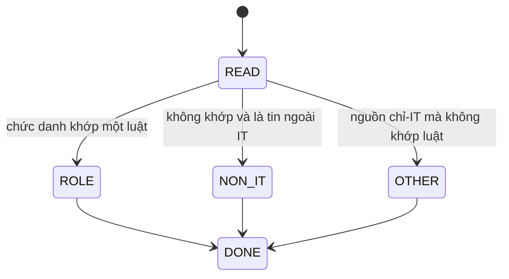

# Specification: SPEC-CLS-68 — Phân loại vai trò, cấp bậc và thành phố

Issue: [#68](https://github.com/Dyuedu/HaiDoIT/issues/68) (Story 1.20). Phép 6 của SPEC-REG-03.

## 1. Context & Problem Statement

Bản đồ cần mỗi tin có một vai trò, một cấp bậc và một thành phố trước khi có mô hình. Nếu luật nằm rải trong pipeline, cùng một chức danh sẽ ra hai nhãn.

Mục tiêu: một hàm thuần, cùng đầu vào cùng cấu hình thì cùng nhãn, không gọi mạng.

## 2. Scope

### 2.1 In-Scope

- `RuleClassifier.classify` cài phép 6. Một tin hoặc một lô.
- Luật đọc chức danh, nguồn, danh mục nguồn, chữ cấp bậc, chữ địa điểm.
- Data/AI tách thành Data Analyst/BI, Data Engineer, AI/ML Engineer. Embedded không vào Other.
- Nhiều thành phố: cụm xuất hiện sớm nhất trong chuỗi địa điểm (`multi_city = first_phrase`).
- Tin không thuộc IT mang nhãn đó và `counts_in_aggregate` trả false. `exclusion_by_source` báo tỷ lệ theo nguồn.
- Nhánh để `None`. Story 1.9 mới gán nhánh.
- Từ khóa nằm trong `ClassifyConfig` phiên bản `classify-v1`.

### 2.2 Out-of-Scope (Non-Goals)

- Không chấm độ chính xác trên 200 JD. Đó là Story 1.9.
- Không ghi nhãn vào Postgres. Chưa có Alembic.
- Không gọi mô hình. Không đọc全文 JD.
- Không thêm phép thứ chín.

## 3. Functional Requirements

### 3.1 Core Features

FR-01: Một tin ra đúng một `Classification`: vai trò, nhánh, cấp bậc, thành phố.

FR-02: Vai trò thuộc danh sách trong cấu hình, hoặc `không thuộc IT`, hoặc `Other` khi nguồn chỉ có tin IT mà chức danh không khớp luật nào.

FR-03: Cấp bậc lấy từ chữ nguồn ghi trước, rồi mới tới chức danh. Không có thì `không xác định`.

FR-04: Thành phố là Hà Nội, TP.HCM, Đà Nẵng, Khác, hoặc không xác định. Nhiều thành phố lấy cụm đứng trước.

FR-05: Lô trả tuple cùng độ dài. Lô rỗng trả `()`.

### 3.2 System Behavior

Hàm không đọc đĩa và không viết kho. Người gọi truyền `PostingFacts` và nhận nhãn. Bảng tổng hợp sau này phải bỏ tin có `counts_in_aggregate` false.

### 3.3 State Machine / Workflow

### 3.4 Data Contracts & Interfaces

Input: `PostingFacts` hoặc list/tuple các fact đó, cộng `ClassifyConfig`.

Output: `Classification` hoặc tuple. `SourceExclusion` cho báo cáo.

Error contracts: `multi_city` khác `first_phrase` thì `ValueError`.

## 4. Safety, Security & Constraints

### 4.1 Safety Requirements

SR-01: Không có số thị trường nào được tính ở module này.

SR-02: Ngưỡng 30 tin của nhánh không nằm ở đây.

### 4.2 Security Requirements

SEC-01: Không mạng, không file, không framework.

SEC-02: Không nhận văn bản JD đầy đủ.

### 4.3 Operational Constraints

Python 3.13. Không thêm dependency.

## 5. Edge Cases & Failure Handling

EC-01: "Kế toán" ra `không thuộc IT` dù nguồn là MoMo. "Backend" kèm danh mục finance vẫn là Backend.

EC-02: "Da Nang / Ha Noi" ra Đà Nẵng. "Hải Phòng" ra Khác. Chuỗi trống hoặc "Remote" ra không xác định.

EC-03: Chữ cấp bậc "Junior" thắng chức danh "Senior Backend".

Mỗi case: kết quả là nhãn, không retry, trạng thái hàm không đổi.

## 6. Acceptance Criteria

AC-01: Data Engineer, Data Analyst và Machine Learning ra ba vai trò khác nhau. Embedded không phải Other.

AC-02: Gọi hai lần cùng tin ra cùng object logic. Một list hai tin ra tuple hai phần tử.

AC-03: Tỷ lệ loại của MoMo trong test là 1/2 khi một tin kế toán và một tin Backend.

## 7. Implementation & Traceability Matrix

| Requirement ID | Type | Description | Implementation Module | Test File |
|---|---|---|---|---|
| FR-01 | FR | Một nhãn cho một tin | `haido_core/domain/classify.py` | `tests/domain/test_ad2_classify.py` |
| FR-04 | FR | Nhiều thành phố | `haido_core/domain/classify.py` | `tests/domain/test_ad2_classify.py` |
| FR-05 | FR | Một tin và một lô | `haido_core/domain/classify.py` | `tests/domain/test_ad2_classify.py` |
| EC-01 | EC | Ngoài IT và Backend | `haido_core/domain/classify.py` | `tests/domain/test_ad2_classify.py` |
| AC-01 | AC | Tách Data và Embedded | `haido_core/domain/classify.py` | `tests/domain/test_ad2_classify.py` |

## 8. Testing Strategy

### 8.1 Unit Tests

Các ví dụ ở mục 6, cộng nguồn itviec không khớp luật thì Other, nguồn zalo thì không thuộc IT.

### 8.2 Integration Tests

Cổng AD-2 vẫn PASS khi class cụ thể duy nhất của `classify` nằm trong `domain/`.

### 8.3 Negative Tests

`multi_city` lạ thì ValueError. Không có test gọi mạng.

### 8.4 Fault Injection Tests

Không áp dụng. Hàm không có I/O để tiêm lỗi.

### 8.5 Hardware / Simulation Tests

Không áp dụng.

## 9. Dependencies & Assumptions

### 9.1 Dependencies

`registry.PostingFacts`, `Classification`, `as_batch`. SPEC-REG-03.

### 9.2 Assumptions

Thứ tự luật trong `classify-v1` là quyết định của spec này. "Cụm đứng trước trong chuỗi" là quy tắc nhiều thành phố. Bộ 200 JD chưa có nên chưa đo accuracy.

## 10. Observability & Logging

Không log. Báo cáo loại theo nguồn là giá trị trả về, không phải log.

## 11. Definition of Done (DoD)

- AC-01 đến AC-03 PASS.
- `uv run pytest tests/domain/test_ad2_classify.py -q` PASS.
- Ruff sạch trên `haido_core` và `tests`.
- Cổng AD-2 vẫn PASS.
- Chưa có người thứ hai review. Spec giữ DRAFT.

## 12. Risks & Open Questions

### 12.1 Technical Risks

RISK-01: Luật từ khóa gán nhầm chức danh lạ. Bộ 200 JD của Story 1.9 sẽ đo, không đoán trước ở đây.

### 12.2 Open Questions

Không còn trong phạm vi story này.

### 12.3 Mitigation

Đổi luật bằng cách đổi `ClassifyConfig`, không sửa nhánh trong `_one`.

## 13. References

- Story 1.20 trong `epics.md`. FR-7 trong PRD.
- SPEC-REG-03.

## 14. Revision History

| Version | Date | Author | Changes |
|---|---|---|---|
| 1.0.0 | 2026-11-06 | @CaoPhanTuanAnh | Luật v1 và hàm thuần. |
