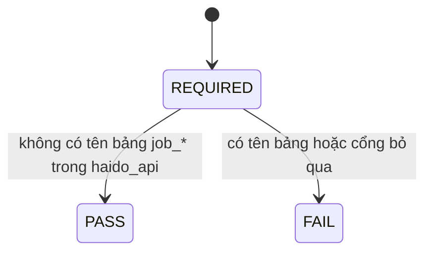

# Specification: SPEC-GATE-09 — Bắt buộc cổng không tổng hợp trên job_*

Phần của [#9](https://github.com/Dyuedu/HaiDoIT/issues/9) thuộc người giữ miền: registry, không tổng hợp trên `job_*`, hình dạng `meta`.

## 1. Context & Problem Statement

Cổng AD-7 đã có và đang PASS, nhưng CI không `--require` nó nên lúc `haido_api/` biến mất cổng sẽ bỏ qua mà PR vẫn xanh. AD-17 đã được `--require` từ #2. AD-2 đã được `--require` từ SPEC-REG-03.

## 2. Scope

### 2.1 In-Scope

Thêm `AD-7` vào `--require` của job gates. SKIP tính là đỏ.

### 2.2 Out-of-Scope (Non-Goals)

- Không viết chín cổng còn thiếu của người khác: một head Alembic, lời dẫn, tất định lộ trình.
- Không đổi luật quét của AD-7. Luật hiện là cấm tên `job_postings` và `job_observations` trong `haido_api/`.

## 3. Functional Requirements

### 3.1 Core Features

FR-01: Lệnh CI là `python tools/gates/check_gates.py --require AD-1 AD-17 AD-2 AD-7`.

### 3.2 System Behavior

`haido_api` không nhắc hai bảng tin thì AD-7 PASS.

### 3.3 State Machine / Workflow

### 3.4 Data Contracts & Interfaces

Không có dữ liệu mới.

## 4. Safety, Security & Constraints

### 4.1 Safety Requirements

SR-01: API không tổng hợp trên bảng tin. Cổng là chốt, không phải nơi tính số.

### 4.2 Security Requirements

SEC-01: Không đọc nội dung tin.

### 4.3 Operational Constraints

Job gates hiện không cần Postgres.

## 5. Edge Cases & Failure Handling

EC-01: `haido_api/` mất thư mục. AD-7 SKIP. Vì đã `--require`, job đỏ.

## 6. Acceptance Criteria

AC-01: `ci.yml` chứa `--require AD-1 AD-17 AD-2 AD-7`.

AC-02: Chạy lệnh đó trên repo này thoát 0.

## 7. Implementation & Traceability Matrix

| Requirement ID | Type | Description | Implementation Module | Test File |
|---|---|---|---|---|
| FR-01 | FR | AD-7 bắt buộc | `.github/workflows/ci.yml` | `tests/domain/test_ad2_registry.py` |
| AC-02 | AC | Cổng xanh | `tools/gates/check_gates.py` | `tests/domain/test_ad2_registry.py` |

## 8. Testing Strategy

### 8.1 Unit Tests

Test đọc `ci.yml`.

### 8.2 Integration Tests

Subprocess chạy đủ bốn mã cổng.

### 8.3 Negative Tests

Không thêm file cố tình vi phạm vào `haido_api`.

### 8.4 Fault Injection Tests

Không áp dụng trên CI thật.

### 8.5 Hardware / Simulation Tests

Không áp dụng.

## 9. Dependencies & Assumptions

### 9.1 Dependencies

`gate_ad7_khong_tong_hop_tren_job` đã có.

### 9.2 Assumptions

Cấm tên bảng trong `haido_api` là đủ cho phần của #9 giao cho miền. Chín cổng đầy đủ vẫn là việc cả nhóm.

## 10. Observability & Logging

Stdout của cổng, như các cổng khác.

## 11. Definition of Done (DoD)

- AC-01 và AC-02 PASS.
- #9 chưa đóng: còn cổng của người khác và chín tên kiểm thử đầy đủ.

## 12. Risks & Open Questions

### 12.1 Technical Risks

RISK-01: Một câu SQL hợp lệ không đụng hai tên bảng đó vẫn lọt. Story sau siết mẫu nếu cần.

### 12.2 Open Questions

Không còn cho phần này.

### 12.3 Mitigation

Giữ nguyên hàm cổng đã có. Chỉ đổi mức bắt buộc.

## 13. References

- Issue #9. AD-5, AD-7, AD-24.

## 14. Revision History

| Version | Date | Author | Changes |
|---|---|---|---|
| 1.0.0 | 2026-11-06 | @CaoPhanTuanAnh | Thêm AD-7 vào --require. |
