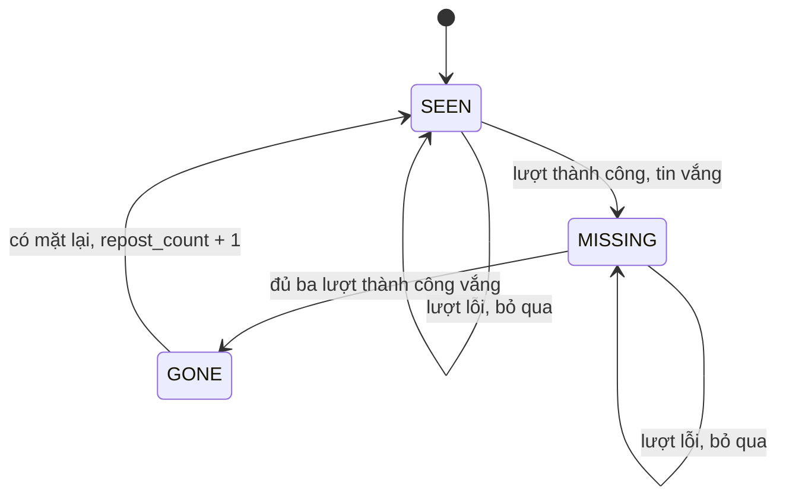

# Specification: SPEC-LIFE-06 — Vòng đời tin theo snapshot

Issue: [#6](https://github.com/Dyuedu/HaiDoIT/issues/6) (Story 1.4). AD-4.

## 1. Context & Problem Statement

Số sau này phải truy về đúng ngày. Nếu vòng đời là một cột bị `UPDATE`, đêm lỗi làm tin trông như đăng lại, và snapshot cũ không tính lại được.

Mục tiêu: hàm thuần trả vòng đời của đúng snapshot được hỏi. Không sửa hàng đã ghi.

## 2. Scope

### 2.1 In-Scope

- `snapshot_id_at` ra `YYYY-MM-DD` theo UTC+7, cùng quy ước Asia/Ho_Chi_Minh đang dùng trong scraper.
- `job_lifecycle` đếm lần thấy trên các lượt thành công của đúng nguồn.
- Vắng ít nhất ba lượt thành công liên tiếp thì `absent`. Xuất hiện lại thì `repost_count` tăng một.
- Lượt `success=false` không tính vắng, không tăng đăng lại, không cắt chuỗi.
- Cửa sổ `window_days` xét `last_seen` của snapshot đang hỏi. Ngày sau snapshot đó không được đọc.
- Gọi hai lần ra cùng kết quả. Đầu vào không bị sửa.

### 2.2 Out-of-Scope (Non-Goals)

- Không tạo bảng `stat_job_lifecycle`. Alembic thuộc #1, chưa có trong repo.
- Không đổi `scraper/ingest.py`. Bảng `job_observations` hiện đã chỉ thêm hàng.
- Không đếm cụm. Đó là phép 3, chưa cài.
- Issue ghi chặn bởi #5. #5 đã sang Sprint 2. Hàm này không chờ #5.

## 3. Functional Requirements

### 3.1 Core Features

FR-01: Ba lượt thành công liên tiếp có mặt tin thì `times_seen` là 3. Lượt lỗi xen giữa không được đếm.

FR-02: Ba lượt thành công vắng mặt thì `absent`. Lượt kế có mặt thì `repost_count` là 1 và `absent` hết.

FR-03: Snapshot cũ không thấy tin của ngày sau, và không bị đêm sau làm đổi `absent`.

FR-04: `in_window` đúng khi `0 <= snapshot - last_seen <= window_days`.

### 3.2 System Behavior

Người gọi đưa danh sách lượt và quan sát. Hàm trả tuple `JobLife`. Không có chế độ ghi.

### 3.3 State Machine / Workflow

### 3.4 Data Contracts & Interfaces

Input: `SourceRun`, `Observation`, `snapshot_id`, `window_days`.

Output: `tuple[JobLife, ...]`, sắp theo nguồn rồi mã tin.

Error contracts: mốc thời gian không có múi giờ, `snapshot_id` sai dạng, hoặc `window_days < 1` thì `ValueError`.

## 4. Safety, Security & Constraints

### 4.1 Safety Requirements

SR-01: Không có lệnh sửa hoặc xóa quan sát.

SR-02: Lượt lỗi không làm tăng `repost_count`.

### 4.2 Security Requirements

SEC-01: Không đọc mô tả tin, không ghi log.

### 4.3 Operational Constraints

Múi giờ cố định UTC+7 vì Việt Nam không có giờ mùa và máy CI không cài gói `tzdata`. Không thêm dependency.

## 5. Edge Cases & Failure Handling

EC-01: Lượt lỗi nằm giữa hai lần vắng. Chuỗi vắng không tăng ở đêm lỗi. Chưa đủ ba thì chưa `absent`.

EC-02: Hỏi snapshot giữa chừng, trước ngày tin xuất hiện lại. `repost_count` vẫn 0 và `absent` true.

EC-03: `last_seen` cách snapshot hơn cửa sổ. `in_window` false, hàng vẫn trả về.

## 6. Acceptance Criteria

AC-01: Chuỗi thấy, lỗi, thấy, thấy cho `times_seen == 3`.

AC-02: Ba đêm vắng rồi một đêm có mặt cho `repost_count == 1`. Hỏi đúng đêm vắng thứ ba thì `absent` và `repost_count == 0`.

AC-03: Hai lần gọi bằng nhau và phần tử đầu vào không đổi.

## 7. Implementation & Traceability Matrix

| Requirement ID | Type | Description | Implementation Module | Test File |
|---|---|---|---|---|
| FR-01 | FR | Ba lần thấy | `haido_core/domain/lifecycle.py` | `tests/domain/test_ad4_lifecycle.py` |
| FR-02 | FR | Biến mất và đăng lại | `haido_core/domain/lifecycle.py` | `tests/domain/test_ad4_lifecycle.py` |
| FR-04 | FR | Cửa sổ 60 ngày | `haido_core/domain/lifecycle.py` | `tests/domain/test_ad4_lifecycle.py` |
| EC-01 | EC | Đêm lỗi | `haido_core/domain/lifecycle.py` | `tests/domain/test_ad4_lifecycle.py` |
| AC-03 | AC | Không sửa đầu vào | `haido_core/domain/lifecycle.py` | `tests/domain/test_ad4_lifecycle.py` |

## 8. Testing Strategy

### 8.1 Unit Tests

Các AC ở trên, cộng mốc 16:30 UTC vẫn là 05/11 và 17:30 UTC sang 06/11.

### 8.2 Integration Tests

Không nối Postgres trong issue này.

### 8.3 Negative Tests

`datetime` không múi giờ thì lỗi.

### 8.4 Fault Injection Tests

Không áp dụng.

### 8.5 Hardware / Simulation Tests

Không áp dụng.

## 9. Dependencies & Assumptions

### 9.1 Dependencies

Thư viện chuẩn. Quan sát append-only đã có ở `scraper/schema.sql`.

### 9.2 Assumptions

`success` trên `SourceRun` nghĩa là listing đi hết. Một đêm pipeline chết được biểu diễn bằng `success=false`, không phải bằng cách xóa hàng.

## 10. Observability & Logging

Không log.

## 11. Definition of Done (DoD)

- AC-01 đến AC-03 PASS.
- Pytest của file test PASS.
- Chưa vật hóa bảng. Việc đó chờ #1.
- Chưa có người thứ hai review.

## 12. Risks & Open Questions

### 12.1 Technical Risks

RISK-01: Ingest hiện vẫn `UPDATE` hàng `jobs`. Story này không đụng bảng đó. Vòng đời không đọc cột `updated_at`.

### 12.2 Open Questions

Không còn.

### 12.3 Mitigation

Khi có Alembic, ghi kết quả `job_lifecycle` thành bảng mới. Không `UPDATE` `job_observations`.

## 13. References

- Story 1.4, AD-4, FR-3.
- `scraper/crawlers/base.py` hàm `today_snapshot`.

## 14. Revision History

| Version | Date | Author | Changes |
|---|---|---|---|
| 1.0.0 | 2026-11-06 | @CaoPhanTuanAnh | Hàm thuần. Chưa có bảng mới. |
