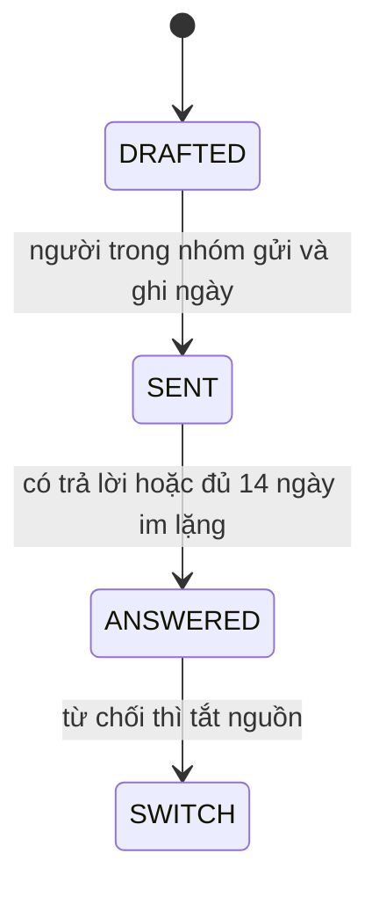

# Specification: SPEC-PERM-08 — Thư xin phép ITviec, TopCV và tác giả repo gốc

Issue: [#8](https://github.com/Dyuedu/HaiDoIT/issues/8).

## 1. Context & Problem Statement

Công tắc ITviec và TopCV, và việc công khai mã scraper, phụ thuộc câu trả lời bằng văn bản. Repo chưa có thư nào.

Mục tiêu của vòng này: ba thư nói đủ mục đích, phạm vi, tần suất và cách gỡ. Chưa gửi, vì không có địa chỉ đã được các bên công bố cho nhóm và không có quyền gửi hộ.

## 2. Scope

### 2.1 In-Scope

- `docs/permissions/itviec.md`, `topcv.md`, `repo-goc.md`.
- Mỗi thư: học thuật, phi thương mại, phạm vi dữ liệu, một lượt mỗi ngày, gỡ trong 48 giờ, từ chối thì tắt nguồn.
- Không viết câu "tuân thủ đầy đủ".
- `README.md` ghi chưa gửi. Cột ngày gửi để trống. Đồng hồ 14 ngày chưa chạy. Công tắc không đổi.

### 2.2 Out-of-Scope (Non-Goals)

- Không gửi thư. Không bịa địa chỉ hộp thư.
- Không tắt ITviec hay TopCV trước khi có trả lời.
- Không sửa User-Agent. Email liên hệ của nhóm chưa được cả nhóm chốt trong repo.

## 3. Functional Requirements

### 3.1 Core Features

FR-01: Đủ ba thư, mỗi thư có các ý ở mục 2.1.

FR-02: Tác giả repo gốc là GitHub `SonPhatTranDeveloper`, repo `IT-Job-Posting`, vì `scraper/README.md` trỏ về đó và repo gốc không có LICENSE.

FR-03: Trạng thái mỗi file là chưa gửi.

### 3.2 System Behavior

Thư là tài liệu. Không có tiến trình gửi.

### 3.3 State Machine / Workflow

Code hiện dừng ở `DRAFTED`.

### 3.4 Data Contracts & Interfaces

Input: không có.

Output: bốn file markdown.

Error contracts: không có runtime.

## 4. Safety, Security & Constraints

### 4.1 Safety Requirements

SR-01: Không khẳng định nhóm đã được cấp phép.

SR-02: Không đổi công tắc nguồn trong thư hay trong code.

### 4.2 Security Requirements

SEC-01: Không ghi mật khẩu, token, hay địa chỉ email cá nhân đoán mò.

### 4.3 Operational Constraints

Gửi thư là việc của người. Issue chưa đóng khi thư còn chưa gửi.

## 5. Edge Cases & Failure Handling

EC-01: Không có địa chỉ ITviec hay TopCV trong repo. Thư ghi kênh công khai trên site, để trống hộp thư.

EC-02: Không có email tác giả. Thư gửi qua GitHub, không qua địa chỉ suy đoán.

EC-03: Ai đó ghi "đã gửi" mà không có ngày. README yêu cầu ngày gửi thì đồng hồ 14 ngày mới chạy. Hiện không ghi đã gửi.

## 6. Acceptance Criteria

AC-01: Ba file chứa "học thuật", "phi thương mại", "một lượt mỗi ngày", "48 giờ", "từ chối", "chưa gửi".

AC-02: Không file nào chứa "tuân thủ đầy đủ".

AC-03: README nói chưa thư nào được gửi và nêu tên ba file.

## 7. Implementation & Traceability Matrix

| Requirement ID | Type | Description | Implementation Module | Test File |
|---|---|---|---|---|
| FR-01 | FR | Ba thư đủ ý | `docs/permissions/` | `tests/domain/test_perm08_emails.py` |
| FR-03 | FR | Chưa gửi | `docs/permissions/README.md` | `tests/domain/test_perm08_emails.py` |
| AC-02 | AC | Không khẳng định tuân thủ | `docs/permissions/` | `tests/domain/test_perm08_emails.py` |

## 8. Testing Strategy

### 8.1 Unit Tests

Đọc file và kiểm các cụm từ.

### 8.2 Integration Tests

Không có.

### 8.3 Negative Tests

Cụm "tuân thủ đầy đủ" không xuất hiện.

### 8.4 Fault Injection Tests

Không áp dụng.

### 8.5 Hardware / Simulation Tests

Không áp dụng.

## 9. Dependencies & Assumptions

### 9.1 Dependencies

`scraper/README.md` cho danh tính repo gốc. PRD §6.1 và §6.2 cho phạm vi xin phép.

### 9.2 Assumptions

Kênh GitHub của tác giả là đường liên hệ hợp lệ khi chưa có email. Ngày gửi sẽ do người ghi vào README sau khi gửi thật.

## 10. Observability & Logging

Bảng trong README là nhật ký. Chưa có dòng ngày.

## 11. Definition of Done (DoD)

- AC-01 đến AC-03 PASS ở mức bản thảo.
- Issue #8 chưa xong theo AC gốc, vì thư chưa gửi và chưa có trả lời.
- Không tắt nguồn.

## 12. Risks & Open Questions

### 12.1 Technical Risks

RISK-01: ITviec vẫn chạy trong lúc chờ thư, đúng quyết định 04–05/11. Thư này không đảo quyết định đó.

### 12.2 Open Questions

Q-01: Hộp thư nào của ITviec và TopCV là hộp thư nhóm sẽ dùng. Chỉ người trong nhóm trả lời được.

### 12.3 Mitigation

Để trống địa chỉ còn hơn điền một địa chỉ đoán.

## 13. References

- Issue #8. PRD §6.1, §6.2.
- `scraper/README.md`.

## 14. Revision History

| Version | Date | Author | Changes |
|---|---|---|---|
| 1.0.0 | 2026-11-06 | @CaoPhanTuanAnh | Ba bản thảo. Chưa gửi. |
