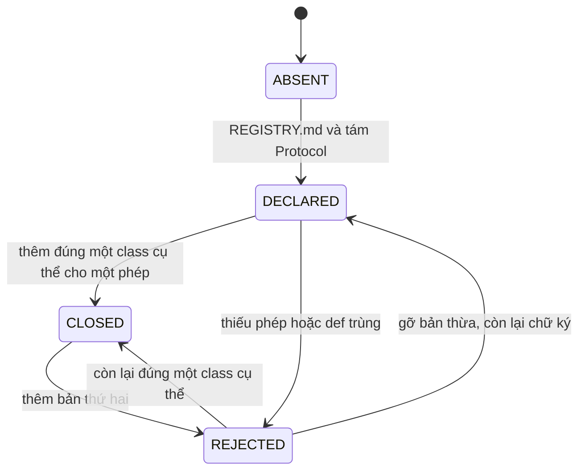

# Specification: SPEC-REG-03 — Tám chữ ký phép dùng chung

Issue: [#3](https://github.com/Dyuedu/HaiDoIT/issues/3) (C-2). Nguồn: AD-2.

## 1. Context & Problem Statement

Hải Đồ IT có tám phép vừa chạy theo lô trong đêm vừa chạy cho một tin lúc người dùng dán. Nếu hai chỗ đó không dùng cùng một chữ ký, số trên bản đồ và số lúc soi tin lệch nhau mà không có kiểm thử nào đỏ.

Hiện `haido_core/domain/` chưa có `REGISTRY.md`. Cổng AD-2 trong `tools/gates/check_gates.py` chỉ tìm tám từ khóa trong file đó, rồi trả PASS. Một hàm thứ hai cùng vai vẫn merge được.

Mục tiêu của module này là chốt hợp đồng: tên hàm, kiểu, một câu phép quyết định gì, và file sẽ cài thân hàm. Chưa cài thuật toán. Cổng CI phải từ chối bản thứ hai.

## 2. Scope

### 2.1 In-Scope

- `haido_core/domain/REGISTRY.md`: đúng tám phép.
- `haido_core/domain/registry.py`: dataclass đầu vào/đầu ra và tám `Protocol`. Method để `...`.
- Một chữ ký nhận một đối tượng hoặc một lô (`list` hoặc `tuple`).
- Cổng AD-2: thiếu phép thì FAIL; `def` cùng tên ngoài `haido_core/domain/` thì FAIL; trong `domain/` được có method của `Protocol` cộng tối đa một method trên class cụ thể.
- Job CI `--require` thêm `AD-2`.
- Kiểm thử trong `tests/domain/test_ad2_registry.py`.

Tám hàm, và file sẽ chứa thân hàm sau này:

| # | Hàm | Phép quyết định | Cài sau |
|---|---|---|---|
| 1 | `map_mentions` | Lượt nhắc thành mã kỹ năng, hoặc "chưa khớp" | `domain/mapping.py` |
| 2 | `select_cell` | Ô thống kê, kèm `n` và nhãn, quay về trong cùng phạm vi | `domain/cells.py` |
| 3 | `population` | Số cụm của ô trong cửa sổ 60 ngày của snapshot | `domain/population.py` |
| 4 | `group_skills` | Nhóm kỹ năng theo θ truyền vào | `domain/skill_groups.py` |
| 5 | `percentiles` | Phân vị, mốc, khoảng tin cậy. Seed là tham số | `domain/percentiles.py` |
| 6 | `classify` | Vai trò, nhánh, cấp bậc, thành phố | `domain/classify.py` |
| 7 | `match_postings` | Một cặp tin có khớp hay không | `domain/matching.py` |
| 8 | `order_path` | Thứ tự lộ trình bốn tầng | `domain/path_order.py` |

### 2.2 Out-of-Scope (Non-Goals)

- Không viết thuật toán của tám phép. Story 1.20, 1.7, 1.8, 1.11, 1.12, 2.6 cài thân hàm sau.
- Không sửa `envelope.py`, `display_policy.py`, `haido_api/`, `scraper/`.
- Không thêm khóa vào `sprint-status.yaml`. C-2 không có khóa story.
- Không có hàm `*_batch`. Không dùng `Sequence` làm kiểu lô, vì `str` là sequence.
- Không ghi nhận "Dyuedu đã xác nhận" trong code. Xác nhận là review PR, trước khi story sau viết thân hàm.
- Không đếm là xong nếu chỉ có file markdown mà cổng vẫn cho qua một `def` trùng.

## 3. Functional Requirements

### 3.1 Core Features

FR-01: `REGISTRY.md` khai đúng tám phép. Mỗi phép có số, tên hàm, một câu phép quyết định gì, chữ ký, và đường dẫn file sẽ cài. File giữ các cụm từ cổng đang tìm: mapping, chọn ô, dân số, nhóm kỹ năng, phân vị, phân loại, so khớp, xếp thứ tự.

FR-02: Mỗi phép là một method trên một `Protocol` trong `registry.py`. Cùng tên đó không có chữ ký thứ hai. `registry.py` chỉ import thư viện chuẩn.

FR-03: Kiểu đầu vào là `T | list[T] | tuple[T, ...]`. Một đối tượng trả một kết quả. Một lô trả `tuple` cùng độ dài. Lô rỗng trả `()`. `str` không phải lô. Hàm `as_batch` phân biệt hai hình này, và không phải một trong tám phép.

FR-04: `select_cell` trả ô, `n` và nhãn trong một kết quả. Chữ ký không có đường quay từ phạm vi thành phố sang toàn quốc. `population` nhận cửa sổ ngày làm tham số. `group_skills` nhận θ làm tham số. `percentiles` nhận seed làm tham số. `classify` trả cả nhánh. Nhánh được để `None` cho tới Story 1.9. `match_postings` nhận một cặp và phạm vi trong nguồn hoặc chéo nguồn. `order_path` trả danh sách mã kỹ năng đã xếp.

FR-05: Cổng AD-2 FAIL khi thiếu cụm từ, khi thiếu method Protocol trong `haido_core/domain/`, khi có hơn một method Protocol cho cùng tên, khi có `def` cùng tên ngoài `domain/`, hoặc khi có hơn một method cụ thể trong `domain/`. Chỉ có Protocol, chưa có class cụ thể, thì PASS. Đúng một class cụ thể thì PASS.

FR-06: Job `gates` gọi `python tools/gates/check_gates.py --require AD-1 AD-17 AD-2`. AD-2 ở trạng thái bỏ qua tính là lỗi.

### 3.2 System Behavior

Ở trạng thái bình thường sau issue này, repo có đủ chữ ký và chưa có thân hàm. Cổng đọc markdown và cây cú pháp Python, không chạy tám phép. Story sau thêm đúng một class trong file "cài sau". Class đó hiện method cùng tên. Cổng vẫn PASS. Thêm class thứ hai, hoặc thêm hàm cùng tên trong `haido_api/` hay `scraper/`, thì cổng FAIL và PR không merge.

### 3.3 State Machine / Workflow

`ABSENT` là chưa có `REGISTRY.md` (cổng bỏ qua). `DECLARED` là chỉ có Protocol. `CLOSED` là đã có một thân hàm. `REJECTED` là cổng FAIL.

### 3.4 Data Contracts & Interfaces

Input:

- Markdown `REGISTRY.md`.
- Cây `*.py` của repo, trừ `tests/`, `tools/`, `.claude/`, `_bmad/`, `_bmad-output/`.
- Với từng phép, một đối tượng dataclass hoặc một `list`/`tuple` các đối tượng đó.

Output:

- `as_batch(value)` trả `None` khi `value` là một đối tượng, trả `tuple` khi là lô.
- Tám method để `...` cho tới story cài thân hàm. Kiểu trả về nằm trên chữ ký.
- Cổng trả PASS, SKIP hoặc FAIL kèm danh sách chỗ vi phạm.

Internal data structures: dataclass đóng băng trong `registry.py` (`Mention`, `MappedMention`, `CellKey`, `CellQuery`, `CellChoice`, `PopulationRequest`, `SkillRate`, `SkillGroupRequest`, `SkillGroup`, `PercentileRequest`, `PercentileResult`, `PostingFacts`, `Classification`, `PostingPair`, `MatchDecision`, `GraphEdge`, `PathSkill`, `PathRequest`). `SkillBand` và `MatchScope` là enum.

External interfaces: không có HTTP, không có bảng, không có CLI mới.

Error contracts: cổng không ném ra ngoài `main`. File Python không parse được thì ghi một dòng vi phạm, không bỏ qua im lặng. `as_batch` không ném với `str`.

## 4. Safety, Security & Constraints

### 4.1 Safety Requirements

SR-01: Module này không tính số thị trường. Method của tám phép không có thân. Không có đường nào trả một tỷ lệ, một phân vị hay một nhãn suy từ văn bản.

SR-02: Ngưỡng mẫu, θ, cửa sổ 60 ngày và seed không có giá trị mặc định trong chữ ký. Người gọi phải truyền vào. Tránh một hằng số 30 hoặc 0.30 nằm trong hợp đồng rồi bị story sau copy.

SR-03: `select_cell` không có tham số "được phép đổi phạm vi". Ô thành phố thiếu mẫu không được biểu diễn bằng một ô toàn quốc.

### 4.2 Security Requirements

SEC-01: `registry.py` không đọc file, không mở mạng, không import `sqlalchemy`, `dagster`, `fastapi`. AD-1 vẫn PASS.

SEC-02: Chữ ký không nhận văn bản CV hay JD đầy đủ. `PostingFacts` chỉ có chức danh, nguồn, danh mục nguồn, chữ cấp bậc và chữ địa điểm. `Mention` chỉ có đoạn lượt nhắc và vị trí.

### 4.3 Operational Constraints

- Python 3.13, thư viện chuẩn. Không thêm dependency.
- Cổng chạy trong job CI hiện có, không cần Postgres.
- Không đụng máy VPS, không đụng pipeline `scraper/`.

## 5. Edge Cases & Failure Handling

EC-01: `REGISTRY.md` thiếu một cụm từ.

- Trigger: xóa "dân số" khỏi markdown.
- Expected Behavior: AD-2 FAIL, dòng báo phép thiếu.
- Recovery Strategy: viết lại mục đó.
- Expected System State: `REJECTED`. Không có thân hàm nào chạy.

EC-02: `def classify` nằm trong `haido_api/` hoặc `scraper/`.

- Trigger: một hàm cùng tên ngoài `haido_core/domain/`.
- Expected Behavior: AD-2 FAIL, báo đường dẫn và số dòng.
- Recovery Strategy: xóa hàm đó, gọi Protocol.
- Expected System State: `REJECTED` cho tới khi hết bản trùng.

EC-03: Hai class không kế thừa `Protocol`, cùng định nghĩa một tên, đều nằm trong `domain/`.

- Trigger: hai thân hàm cho một phép.
- Expected Behavior: AD-2 FAIL, báo cả hai chỗ.
- Recovery Strategy: giữ một class.
- Expected System State: `REJECTED`.

EC-04: Lô rỗng, hoặc một chuỗi `str` được đưa vào `as_batch`.

- Trigger: `()` hoặc `"Hà Nội"`.
- Expected Behavior: `()` với lô rỗng. `None` với `str`, vì `str` là một đối tượng, không phải lô.
- Recovery Strategy: người gọi sửa kiểu. Hàm không đoán mã.
- Expected System State: vẫn `DECLARED`.

EC-05: File `.py` trong vùng quét không parse được.

- Trigger: lỗi cú pháp.
- Expected Behavior: AD-2 FAIL, báo file đó.
- Recovery Strategy: sửa cú pháp rồi chạy lại cổng.
- Expected System State: `REJECTED`.

## 6. Acceptance Criteria

AC-01: Given `REGISTRY.md` đã có, when đọc file, then có đúng tám hàng của mục 2.1, mỗi hàng có tên hàm, chữ ký, một câu quyết định và file sẽ cài, và có đủ tám cụm từ của FR-01.

AC-02: Given một phép, when nhìn `Protocol`, then chỉ có một method cho tên đó, kiểu nhận một đối tượng hoặc một lô, và không có method `*_batch`.

AC-03: Given một dataclass, when gọi stub trong `tests/` qua `as_batch`, then một đối tượng ra một kết quả và một `list` ra `tuple` cùng độ dài. `()` ra `()`.

AC-04: Given `def` cùng tên ngoài `haido_core/domain/`, when cổng AD-2 chạy trên cây đó, then FAIL.

AC-05: Given repo chỉ có Protocol, when chạy `python tools/gates/check_gates.py --require AD-1 AD-17 AD-2`, then thoát 0 và AD-2 PASS.

## 7. Implementation & Traceability Matrix

| Requirement ID | Type | Description | Implementation Module | Test File |
|---|---|---|---|---|
| FR-01 | FR | Markdown đủ tám phép | `haido_core/domain/REGISTRY.md` | `tests/domain/test_ad2_registry.py` |
| FR-02 | FR | Tám Protocol, một chữ ký | `haido_core/domain/registry.py` | `tests/domain/test_ad2_registry.py` |
| FR-03 | FR | Một đối tượng hoặc một lô | `haido_core/domain/registry.py` | `tests/domain/test_ad2_registry.py` |
| FR-04 | FR | Trường bắt buộc trên từng phép | `haido_core/domain/registry.py` | `tests/domain/test_ad2_registry.py` |
| FR-05 | FR | Cổng chặn bản thứ hai | `tools/gates/check_gates.py` | `tests/domain/test_ad2_registry.py` |
| FR-06 | FR | CI bắt buộc AD-2 | `.github/workflows/ci.yml` | `tests/domain/test_ad2_registry.py` |
| SR-01 | SR | Không có thân hàm tính số | `haido_core/domain/registry.py` | `tests/domain/test_ad2_registry.py` |
| SR-02 | SR | Ngưỡng và θ là tham số | `haido_core/domain/registry.py` | `tests/domain/test_ad2_registry.py` |
| SR-03 | SR | Không có cờ đổi phạm vi | `haido_core/domain/registry.py` | `tests/domain/test_ad2_registry.py` |
| SEC-01 | SEC | Không I/O, không framework | `haido_core/domain/registry.py` | `tests/domain/test_ad2_registry.py` |
| SEC-02 | SEC | Không nhận full CV/JD | `haido_core/domain/registry.py` | `tests/domain/test_ad2_registry.py` |
| EC-01 | EC | Markdown thiếu phép | `tools/gates/check_gates.py` | `tests/domain/test_ad2_registry.py` |
| EC-02 | EC | def ngoài domain | `tools/gates/check_gates.py` | `tests/domain/test_ad2_registry.py` |
| EC-03 | EC | Hai class cụ thể | `tools/gates/check_gates.py` | `tests/domain/test_ad2_registry.py` |
| EC-04 | EC | Lô rỗng và str | `haido_core/domain/registry.py` | `tests/domain/test_ad2_registry.py` |
| EC-05 | EC | File Python hỏng | `tools/gates/check_gates.py` | `tests/domain/test_ad2_registry.py` |
| AC-01 | AC | Đọc đủ tám phép | `haido_core/domain/REGISTRY.md` | `tests/domain/test_ad2_registry.py` |
| AC-02 | AC | Một chữ ký trên Protocol | `haido_core/domain/registry.py` | `tests/domain/test_ad2_registry.py` |
| AC-03 | AC | Hình một đối tượng và một lô | `haido_core/domain/registry.py` | `tests/domain/test_ad2_registry.py` |
| AC-04 | AC | Cổng FAIL khi trùng | `tools/gates/check_gates.py` | `tests/domain/test_ad2_registry.py` |
| AC-05 | AC | Cổng PASS khi chỉ có chữ ký | `tools/gates/check_gates.py` | `tests/domain/test_ad2_registry.py` |

## 8. Testing Strategy

### 8.1 Unit Tests

Đọc `REGISTRY.md` và chữ ký bằng `typing.get_type_hints` cùng AST của `registry.py`. Kiểm `as_batch` với một đối tượng, một list, một tuple, lô rỗng và `str`. Stub trong `tests/` chứng minh một kết quả so với một tuple. Stub không nằm trong vùng cổng quét.

### 8.2 Integration Tests

Chạy `ad2_status` trên repo thật: AD-2 PASS, và `python tools/gates/check_gates.py --require AD-1 AD-17 AD-2` thoát 0. Không cần Postgres.

### 8.3 Negative Tests

Cây tạm thiếu cụm từ, có `def` ngoài `domain/`, có hai class cụ thể, có hai `Protocol` cho cùng tên. Kỳ vọng FAIL.

### 8.4 Fault Injection Tests

Ghi một file `.py` không parse được vào cây tạm. Kỳ vọng FAIL và có tên file trong báo cáo.

### 8.5 Hardware / Simulation Tests

Không áp dụng. Không có phần cứng và không có mô phỏng runtime của tám phép.

## 9. Dependencies & Assumptions

### 9.1 Dependencies

- Python 3.13, `ast`, `dataclasses`, `enum`, `typing`.
- Pytest và Ruff đã có trong nhóm dev.
- Cổng AD-1 và AD-17 đã xanh từ #2. Issue này không đổi hai cổng đó.
- Tám cụm từ trong `gate_ad2_registry_dong` giữ nguyên.

### 9.2 Assumptions

- "Một bản cài" nghĩa là tối đa một method cụ thể cho mỗi tên, cộng method trên `Protocol`. Kế thừa method mà không viết lại `def` không tính là bản thứ hai.
- Xác nhận của người thứ hai xảy ra lúc review PR, không phải một trường trong repo.
- Story sau đặt class vào đúng file "cài sau" trong `haido_core/domain/`.

## 10. Observability & Logging

Không log. Không metric. Không sự kiện. Chẩn đoán duy nhất là stdout của cổng: mã AD-2, trạng thái, và tối đa mười dòng đường dẫn. Đủ để sửa PR. Không ghi nội dung tin tuyển dụng.

## 11. Definition of Done (DoD)

- FR-01 đến FR-06 có trong code.
- SR-01 đến SR-03 và SEC-01, SEC-02 đúng như chữ ký, vì không có thân hàm để kiểm bằng số.
- AC-01 đến AC-05 PASS.
- `uv run pytest tests/domain/test_ad2_registry.py -q` PASS.
- `uv run python tools/gates/check_gates.py --require AD-1 AD-17 AD-2` thoát 0.
- `uv run ruff check haido_core tests` sạch.
- Không có lỗi chặn merge mới trên các cổng đang `--require`.
- Ma trận mục 7 khớp file thật.
- Spec này là tài liệu hợp đồng. Không thêm README vì không có CLI mới.

## 12. Risks & Open Questions

### 12.1 Technical Risks

RISK-01: Story sau đặt thân hàm ngoài `domain/` vì tiện file pipeline. Cổng sẽ đỏ. Đó là việc cổng phải làm, không phải lỗ hổng.

RISK-02: Một hàm lồng tên trùng trong file được phép có thể bị tính là bản cụ thể. Vùng quét bỏ `tests/` để stub kiểm thử không tự làm đỏ cổng.

### 12.2 Open Questions

Không còn. Tên hàm và quy tắc một-đối-tượng / một-lô đã chốt trong spec này.

### 12.3 Mitigation

Cổng đọc AST, không đọc comment. Thêm phép thứ chín đòi sửa cả markdown, Protocol và danh sách tên trong cổng, trong cùng một PR.

## 13. References

- `_bmad-output/planning-artifacts/architecture/architecture-HaiDoIT-2026-11-03/ARCHITECTURE-SPINE.md` mục AD-2, AD-3, AD-6, AD-7.
- `_bmad-output/planning-artifacts/epics.md` mục tám phép dùng chung, Story 1.7, 1.8, 1.9, 1.11, 1.12, 1.20.
- `_bmad-output/planning-artifacts/DOD.md` dòng 5 và dòng 11–12.
- Issue #3.

## 14. Revision History

| Version | Date | Author | Changes |
|---|---|---|---|
| 1.0.0 | 2026-11-06 | @CaoPhanTuanAnh | Bản đầu. Hợp đồng tám phép, chưa có thân hàm. |
