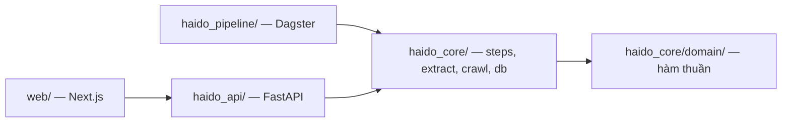
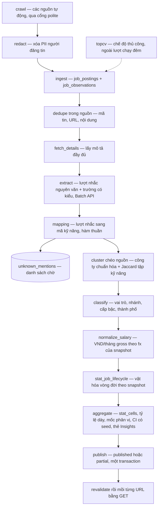
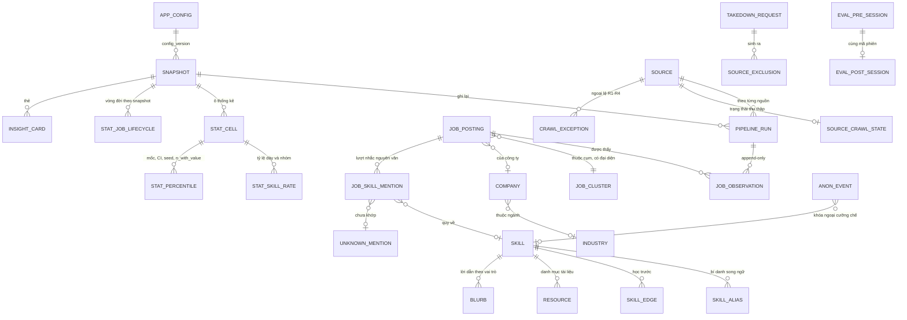
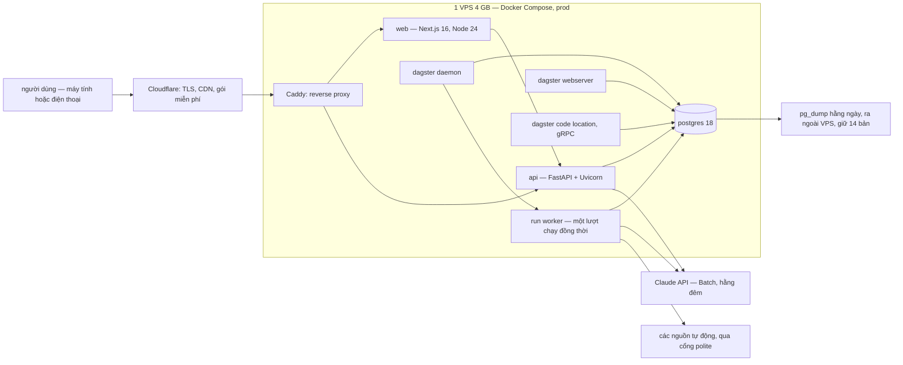

# Architecture Spine — Hải Đồ IT

## Design Paradigm

**Bên ghi là pipes-and-filters, bên đọc là read-model.** Một lượt chạy hằng đêm đi qua chuỗi bước thuần và kết thúc bằng việc công bố một **snapshot bất biến**. Mọi thứ phục vụ người dùng chỉ *đọc* snapshot đã công bố.

Vì sao paradigm này thay vì CRUD: ba lời hứa trung tâm — **tất định**, **truy vết về snapshot**, **vẫn chạy trên snapshot cũ khi pipeline lỗi** — là hệ quả miễn phí của việc tách bên ghi theo lô khỏi bên đọc chỉ-đọc.

Nhưng paradigm đó **chưa đủ**, vì sản phẩm có **năm bộ máy sinh số**, và mỗi bộ bị gọi ở cả hai phía: một lần theo lô trong đêm, một lần cho một tin đơn lúc người dùng dán. Nếu hai lần đó không là cùng một đoạn mã, con số của Soi tin và con số của Insights sẽ khác nhau mà không ai thấy. Đó là lý do AD-2 dựng một **registry đóng** của các phép dùng chung — bất biến quan trọng nhất của spine này.

Bốn tầng, ánh xạ thẳng sang package:

| Tầng | Package | Được biết gì |
|---|---|---|
| Miền nghiệp vụ | `haido_core/domain/` | Không gì cả: hàm thuần, không I/O, không framework |
| Lưu trữ và các bước | `haido_core/db/`, `haido_core/steps/`, `haido_core/extract/`, `haido_core/crawl/` | Biết `domain` và Postgres |
| Điều phối và phục vụ | `haido_pipeline/`, `haido_api/` | Biết `haido_core`; không biết nhau |
| Giao diện | `web/` | Chỉ biết hợp đồng HTTP của `haido_api` |

## Invariants & Rules

### AD-1 — Hướng phụ thuộc một chiều

- **Binds:** tất cả
- **Prevents:** `domain` kéo theo SQLAlchemy hay Dagster rồi không test được bằng hàm thuần; `web/` mở kết nối Postgres riêng từ một tiến trình công khai và nhân bản logic truy vấn ra ngoài `haido_core`
- **Rule:** phụ thuộc chỉ đi theo chiều mũi tên dưới đây. `web/` **không bao giờ** kết nối Postgres — kể cả lúc sinh trang nội dung công khai; nó gọi `haido_api`. Một `import` hay một chuỗi kết nối đi ngược chiều là lỗi, chặn ở CI (AD-24).



### AD-2 — Bộ máy dùng chung: một bản cài đặt, registry đóng

- **Binds:** FR-4, FR-6, FR-7, FR-9, FR-12, FR-22, FR-26..FR-32, FR-37..FR-39, FR-46
- **Prevents:** đây là bất biến gốc của spine. Mỗi phép sinh số bị gọi ở hai nơi cách nhau 2–4 tuần trong lịch sprint, nên bản thứ hai luôn được viết lại "cho nhanh". Cụ thể đã kiểm: nếu FR-27 nhận diện vai trò/cấp bậc khác FR-7, người dùng được so vào **một ô thống kê không phải ô mà tin của họ thuộc về**, và mức khớp, phân vị, D1, D3 đều tính sai mà không kiểm thử nào đỏ
- **Rule:** mọi phép sinh số hoặc phép quyết định phân loại được dùng ở **từ hai nơi** phải nằm trong `haido_core/domain/` và có tên trong registry đóng `haido_core/domain/REGISTRY.md`. v1 có đúng **tám** phép:

  | # | Phép | Dùng ở |
  |---|---|---|
  | 1 | mapping lượt nhắc → mã kỹ năng | FR-6 (đêm), FR-12, FR-26 |
  | 2 | chọn ô thống kê + thứ tự quay về | FR-19, FR-27, FR-30, FR-34, FR-38 |
  | 3 | dân số của ô (cửa sổ 60 ngày, đếm theo cụm) | mọi con số thị trường |
  | 4 | nhóm kỹ năng theo θ | FR-9, FR-20, FR-29 |
  | 5 | phân vị, mốc, khoảng tin cậy | FR-9, FR-30, D1, D3 |
  | 6 | phân loại vai trò / nhánh / cấp bậc / thành phố | FR-7 (đêm), FR-26, FR-27 |
  | 7 | so khớp tin (trong nguồn và chéo nguồn) | FR-4 (đêm), FR-32 |
  | 8 | xếp thứ tự lộ trình, quy tắc 4 tầng | FR-22 |

  Mỗi phép có **đúng một chữ ký**, và chữ ký đó gọi được cho **một** đối tượng đơn lẻ *và* cho **một lô** — không có biến thể "chỉ dùng theo lô". Thêm phép thứ chín thì sửa registry trong cùng PR. Không nơi nào ngoài `domain/` được cài lại bất kỳ phép nào trong tám phép đó.

### AD-3 — Cổng trích xuất trả dữ kiện neo vào văn bản; mọi phép quy chuẩn là tất định

- **Binds:** FR-6, FR-8, FR-12, FR-26, FR-27, FR-29, FR-30, FR-31 (D5–D7), FR-46
- **Prevents:** hai thất bại đối xứng. Nếu cổng trả **mã kỹ năng**, thì thêm một bí danh vào bộ từ vựng buộc gọi lại LLM cho toàn bộ tin lịch sử — đốt chi phí trái §6.4 và làm số hôm nay không so sánh được với hôm qua. Nếu cổng **chỉ** được trả lượt nhắc, thì số năm kinh nghiệm (FR-6), lương (FR-8), kênh liên hệ (D5), đòi tiền trước (D6), tên công ty (D7) và các mục chất lượng JD (FR-46) không còn đường nào ra khỏi văn bản, và dev Soi tin ở Sprint 4 buộc phải phá AD-2 hoặc phá AD-3 — cả hai đều có lý do chính đáng lúc đó
- **Rule:** cổng trả về hai thứ, cả hai **neo vào văn bản gốc**: (a) các lượt nhắc kỹ năng **nguyên văn** kèm vị trí; (b) một **tập trường có kiểu đã đóng** — khoảng số năm kinh nghiệm, khoảng lương kèm đơn vị nguyên văn, kênh liên hệ, dấu hiệu thu phí, tên công ty, các mục kiểm chất lượng JD — mỗi trường kèm đoạn văn bản đã sinh ra nó. Cổng **không bao giờ** trả mã kỹ năng, nhãn vai trò/cấp bậc, hay một con số nó tự tính. Việc quy lượt nhắc về mã, quy lương về VND, và quy văn bản về nhãn phân loại là các phép tất định trong `domain` (phép 1 và 6 của AD-2), không gọi mạng. Đổi bộ từ vựng ⇒ chạy lại **mapping**, không chạy lại LLM.

### AD-4 — Snapshot bất biến; quan sát là append-only; vòng đời được vật hóa

- **Binds:** FR-1, FR-3, FR-9, FR-15, FR-31 (D4), §3 cửa sổ 60 ngày, NFR tất định / truy vết / khả dụng
- **Prevents:** vòng đời tin là thuộc tính **xuyên** snapshot (ngày thấy đầu/cuối, số lần thấy, số lần đăng lại đổi mỗi đêm) trong khi snapshot phải bất biến. Nếu vòng đời là `UPDATE` tại chỗ trên bảng tin: D4 không truy vết và không tất định, cửa sổ 60 ngày không tính lại được, và quy tắc FR-3 "vắng mặt ≥ 3 **lượt chạy thành công của chính nguồn đó**" không viết được thành truy vấn, vì bản ghi tin không treo vào lượt chạy nào
- **Rule:**
  - `job_observations` là bảng **append-only**, mỗi hàng treo vào một `pipeline_run` cụ thể. Không bao giờ `UPDATE` vòng đời tại chỗ.
  - `stat_job_lifecycle` vật hóa vòng đời **theo từng snapshot**, dẫn xuất từ `job_observations`. Vòng đời đếm theo lượt chạy của chính nguồn, bằng phép số 3 của registry.
  - **Cửa sổ 60 ngày xét trên vòng đời thuộc snapshot đang dùng**, không trên trạng thái hiện thời. Thiếu câu này thì tính lại một snapshot cũ sai cả hai chiều: tin chết sau đó bị loại oan, tin đăng lại sau đó lọt vào ô cũ.
  - Snapshot chỉ do bước `open_snapshot` tạo, và kết thúc ở đúng một trong hai trạng thái: `published` (mọi nguồn **tự động** đang bật có `pipeline_run` thành công) hoặc `partial`. Cả hai đều đọc được; `partial` mang `sources_failed[]` và lộ ra ở `meta` (AD-17). Việc chuyển trạng thái nằm trong một transaction duy nhất, sau khi mọi bảng tổng hợp đã ghi xong.
  - Hàng thuộc snapshot đã công bố **không bao giờ** bị sửa hay xóa. Mọi nhu cầu "tính lại" sinh ra một snapshot **mới** (xem AD-21).

### AD-5 — Tầng phục vụ không tổng hợp trên bảng tin

- **Binds:** FR-19, FR-20, FR-27..FR-31, FR-33, FR-34, FR-37, FR-38, FR-46
- **Prevents:** mỗi tính năng tự viết một câu truy vấn tổng hợp riêng, rồi Insights và Soi tin ra hai con số cho cùng một thứ. Và — nguy hiểm hơn — một câu Rule phát biểu quá chặt sẽ bị *thoát ra* chứ không được tuân thủ: nếu Rule chỉ cho "đặt một giá trị vào mốc đã tính sẵn" thì FR-28 (mức khớp), D2 và FR-46 không nằm trong ngoại lệ đó, và người ta sẽ viết `GROUP BY skill_id` trong `haido_api` rồi tự gọi đó là "tra cứu"
- **Rule:** `haido_api` không được chạy `GROUP BY`, phân vị, `AVG` hay `COUNT` trên bất kỳ bảng `job_*`. Được phép: tra cứu theo khóa trên bảng `stat_*`, và tính toán trên **một** tin người dùng dán — nhưng chỉ bằng cách gọi các phép của registry (AD-2), không bao giờ bằng SQL tổng hợp tự viết. Chặn ở CI (AD-24).
- **Rule bổ sung — bảng tỷ lệ phải dày:** `stat_skill_rate` có một hàng cho **mọi** kỹ năng của ô, kể cả tỷ lệ 0. Hàng thiếu là lỗi dữ liệu, không phải "coi như 0". Lý do: nếu bảng cài thưa, kỹ năng không có hàng bị bỏ khỏi **mẫu số** của FR-28, cho mức khớp 16/16 = 100% thay vì 16/18 = 89% — và vì kiểm thử FR-28 dùng đúng ví dụ 16/18, lỗi này sống qua CI.

### AD-6 — Ô thống kê được vật hóa; thứ tự quay về không bao giờ vượt phạm vi

- **Binds:** §3 Bảng thuật ngữ, FR-19, FR-27, FR-30, FR-34, FR-37, FR-38
- **Prevents:** Cố vấn và Soi tin mỗi bên tự hiểu chuỗi quay về, rồi cùng một người dùng thấy hai nhãn cỡ mẫu khác nhau. Và: hàm chọn ô có tham số phạm vi, nên gọi được cho ô **thành phố × vai trò** rồi âm thầm quay về ô toàn quốc — khiến thẻ "Khác biệt giữa Hà Nội và TP.HCM" được tính trên dữ liệu toàn quốc
- **Rule:** `stat_cells` là bảng thật, khóa `(snapshot_id, role, branch, seniority, scope)`, lưu kèm `n` và cơ cấu cấp bậc. Phép số 2 của registry là **đường duy nhất** chọn ô, và nó trả về ba thứ không tách rời nhau: ô đã chọn, `n`, và nhãn giải thích. Chuỗi quay về **chỉ đi trong cùng một phạm vi**: ô thành phố không bao giờ quay về ô toàn quốc; khi ô thành phố không đủ mẫu, kết quả là "chưa đủ dữ liệu", không phải một con số của phạm vi khác. Nhãn nhóm kỹ năng luôn mang theo ô đã sinh ra nó.

### AD-7 — Thứ tự lộ trình học chỉ tồn tại ở Python

- **Binds:** FR-20, FR-22, FR-24, NFR "trong vòng 1 giây"
- **Prevents:** cài lại quy tắc 4 tầng bằng TypeScript để đạt phản hồi tức thì, rồi hai thứ tự khác nhau tồn tại song song và SM-8 sụp
- **Rule:** API trả về lộ trình **đã xếp thứ tự**. `web/` không có sắp xếp topo, không có so sánh 4 tầng, không có θ. Xem thêm AD-22 về mọi phép số học khác trên mã kỹ năng.

### AD-8 — LLM không bao giờ sinh con số, thứ tự, hay câu kết luận

- **Binds:** FR-22, FR-23, FR-31, FR-37, FR-39, §7
- **Prevents:** một con số do LLM bịa lọt ra giao diện; mất tính tất định của thứ tự học và của câu kết luận Insights
- **Rule:** LLM chỉ được gọi ở ba chỗ lúc chạy — trích dữ kiện từ JD hằng đêm (FR-6), từ CV (FR-12), từ tin được dán (FR-26) — cộng một bước **offline** soạn sẵn lời dẫn cho từng cặp kỹ năng × vai trò (FR-23), có lưu lại và rà soát. Văn bản do LLM sinh không được chứa chữ số nào ngoài chữ số nằm trong tên công nghệ. Insights không gọi LLM. Chặn ở CI (AD-24).

### AD-9 — Một cổng trích xuất, dán nhãn phiên bản, có trần

- **Binds:** FR-6, FR-12, FR-26, §6.4, NFR 15 giây, NFR truy vết
- **Prevents:** hai nhà cung cấp LLM với hai cách đánh phiên bản; một kết quả không truy ngược được về model và prompt; hai endpoint POST công khai gọi API có phí mà không có trần, đánh thẳng trần 5–10 USD/tháng
- **Rule:**
  - Mọi lệnh gọi LLM đi qua một interface duy nhất trong `haido_core/extract/`. Mỗi bản ghi kết quả lưu `model_id`, `prompt_version`, `vocab_version`. Model và prompt chọn bằng cấu hình. v1 chỉ dùng Claude.
  - Cấu trúc đầu ra khai bằng **`output_config.format`**, không bằng `tool_choice` cưỡng bức: `tool_choice` dạng `any`/`tool` trả 400 trên `claude-sonnet-5-5`, nên khuôn forced-tool-use sẽ chạy với model lô nhưng **vỡ đúng đường người dùng dán** (FR-12, FR-26).
  - Đường lúc chạy **không được phụ thuộc vào việc tắt thinking**: `thinking: {type: "disabled"}` cũng trả 400 trên `claude-sonnet-5-5`, và mặc định là `effort: high`. Độ trễ của đường này phải được đo ở Sprint 2 đối chiếu ngân sách 15 giây, trước khi chốt model.
  - **Lô Batch hết hạn sau 24 giờ.** Một lô không hoàn thành ⇒ lượt chạy kết thúc `partial` (AD-4), không bao giờ công bố một snapshot thiếu một phần như thể nó đủ.
  - Hai endpoint POST công khai có giới hạn kích thước và giới hạn tốc độ theo IP, cấu hình được (AD-10).

### AD-10 — Mọi tham số hiệu chỉnh được là dữ liệu có phiên bản

- **Binds:** FR-1, FR-7, FR-8, FR-9, FR-31, FR-38, §3
- **Prevents:** đổi θ phải triển khai lại, trái hẳn FR-9; số 30 nằm rải rác ở sáu chỗ trong code rồi FR-7 đếm một dân số khác §3; và không biết con số hôm qua được tính bằng tham số nào
- **Rule:** nằm trong bảng cấu hình có phiên bản, không có hằng số nào trong code: θ_core, θ_common, **ngưỡng mẫu n = 30**, **cửa sổ 60 ngày**, **ngưỡng 30 tin để tạo nhánh**, **ngưỡng 5 điểm phần trăm** của FR-38, tỷ giá USD, công tắc từng nguồn, ngưỡng từng dấu hiệu D1–D7, số lần lấy mẫu bootstrap `B`, estimator phân vị, trần kích thước và tốc độ của hai endpoint POST. Mỗi snapshot lưu `config_version` đã dùng.
- **Rule bổ sung — một hệ quy chiếu tiền tệ:** tỷ giá dùng để quy đổi lương của tin người dùng dán là tỷ giá **của snapshot đang dùng**, không phải tỷ giá hôm nay. Nếu không, D3 so một giá trị quy đổi hôm nay với P25 quy đổi đêm snapshot — lệch một phía có hệ thống.

### AD-11 — Nội dung người dùng là phù du; có đúng một đường ghi

- **Binds:** FR-10, FR-12, FR-14, FR-17, FR-26, FR-29, NFR quyền riêng tư
- **Prevents:** ba đường rò đã kiểm. (a) Một người thêm log request body để debug. (b) FR-29 đòi ghi lượt nhắc chưa nhận diện **từ tin người dùng dán** vào danh sách chờ, nên dev sẽ nhồi từ khóa nguyên văn vào `anon_events.skill_code` — đúng chữ của mọi AD, kiểm thử "không bảng nào nhận văn bản JD" vẫn xanh, nhưng vì hàng đó gắn mã phiên, một phần JP người dùng dán khôi phục lại được. (c) Mặc định `SpooledTemporaryFile` 1 MB của FastAPI ghi CV 5 MB xuống đĩa trong khi AD này hứa không chạm đĩa
- **Rule:**
  - File tải lên xử lý trong bộ nhớ: trần kích thước cưỡng chế **trước** khi đọc body, và ngưỡng spool cấu hình trên 5 MB hoặc stream không qua đĩa. Có kiểm thử chạy một CV 5 MB rồi xác nhận không file tạm nào được tạo.
  - Đường ghi duy nhất cho lượt nhắc chưa nhận diện từ tin dán là bảng `unknown_mentions_pasted`, chỉ ba cột `(keyword, freq, last_seen_date)`, **không mã phiên**, có `CHECK` giới hạn độ dài và ký tự.
  - `anon_events` có **đúng bốn** trường mà FR-17 liệt kê, và `skill_code` có **khóa ngoại tới `skills.code` cưỡng chế ở DB** — nên nó không thể nhận một chuỗi phát sinh từ văn bản người dùng.
  - Access log của Caddy và của API không ghi body. Không bảng nào nhận văn bản CV hay JD. Chặn ở CI (AD-24).

### AD-12 — Hai loại cạnh kỹ năng không bao giờ trộn `[ADOPTED]`

- **Binds:** FR-22, FR-37
- **Prevents:** dùng tần suất xuất hiện làm trọng số đường đi, rồi ra một thứ tự học không có nghĩa sư phạm nào
- **Rule:** `skill_edges` chỉ chứa cạnh `PREREQUISITE` soạn tay, mỗi cạnh có nguồn tài liệu và biên bản rà soát. Tần suất và đồng xuất hiện nằm ở bảng tổng hợp, chỉ dùng cho tầng 2–3 của quy tắc 4 tầng. Không phép tìm đường có trọng số nào đi qua cả hai loại.

### AD-13 — Trang công khai được sinh lại, không chỉ được đánh dấu hết hạn

- **Binds:** FR-48, FR-3, NFR trung thực của con số
- **Prevents:** trang SEO hiện số đêm nay khi API trả số đêm qua. Và cái bẫy cụ thể: `revalidatePath` **chỉ đánh dấu cache hết hạn, không sinh lại trang** — tài liệu Next nói regeneration xảy ra ở request kế tiếp. Nếu chỉ gọi nó, cửa sổ lệch số vẫn hở cho tới request đầu tiên tới **từng** URL, và người chịu là bot Google đến đầu tiên sau mỗi đêm
- **Rule:** sau khi snapshot chuyển `published` hoặc `partial`, bước cuối của pipeline làm hai việc, theo thứ tự: gọi route làm mới (`revalidatePath`) bằng secret dùng chung, **rồi mồi từng URL trong sitemap bằng một `GET`** để trang được sinh lại trước khi người đọc đầu tiên tới. Bước mồi thất bại thì lượt chạy báo lỗi. Trang nội dung không bao giờ render động theo request. Mỗi trang in rõ ngày snapshot, cỡ mẫu, danh sách nguồn đang bật.

### AD-14 — Trang công khai chỉ đọc số tổng hợp, qua API

- **Binds:** FR-48, FR-47, §6.2
- **Prevents:** toàn văn JD hoặc trường dài của tin lọt vào một trang được index — đúng loại rủi ro pháp lý §6.2 đang tránh
- **Rule:** template trang công khai chỉ gọi các endpoint `stat_*` của `haido_api`; nó không có đường nào tới bảng tin thô. Không render trường `description` ở bất kỳ đâu trong phần công khai.

### AD-15 — Trình điều phối là lớp vỏ mỏng, và nằm trong ngân sách tài nguyên

- **Binds:** FR-1, FR-3, FR-9, §6.4, toàn bộ pipeline
- **Prevents:** bị khóa vào Dagster ở tuần 1 với deadline 8 tuần; không chạy lại được một bước khi debug; và vượt RAM của VPS đúng vào khoảnh khắc duy nhất hệ thống phải làm việc thật. Dagster theo tài liệu của chính nó cần **ba** service long-running — webserver, daemon, code location gRPC server — cộng **một run worker cho mỗi lượt chạy**, và run worker chính là nơi bootstrap `B = 1.000` tiêu RAM
- **Rule:**
  - Mỗi bước pipeline là một hàm trong `haido_core/steps/`, gọi được bằng CLI, **không `import` gì của Dagster**. `haido_pipeline/` chỉ chứa định nghĩa asset và partition.
  - Một snapshot = một daily partition, với **timezone khai tường minh** `Asia/Ho_Chi_Minh`. Mặc định của `DailyPartitionsDefinition` là UTC, lệch 7 giờ so với `snapshot_id`.
  - Trên prod: **đúng một lượt chạy đồng thời**; bootstrap chạy theo lô có trần bộ nhớ; `next build` **không bao giờ** chạy trên prod — image build ở máy dev rồi đẩy lên; Dagster UI không bật thường trực; có swap.

### AD-16 — Ranh giới của scraper kế thừa, theo giao diện code thật

- **Binds:** FR-1, FR-2, FR-3, FR-4, `scraper/`
- **Prevents:** câu Rule cũ của AD này mô tả sai thực tế, và lỗi đó đắt. Đã đọc code: **không crawler nào trả về danh sách bản ghi.** Giao diện công khai duy nhất của cả 9 module là `main()` không tham số, tự `argparse`, tự ghi JSONL từng trang, tự `print`; `careerlink` và `itnavi` còn **đọc chính file output** để dựng tập đã-làm, cộng một file state JSON; `topcv` và `linkedin` gọi `interactive_scrape` — vòng lặp tới `KeyboardInterrupt`, cần người thật đăng nhập và bấm sang trang. "Giữ nguyên giao diện hiện tại" hiểu đúng chữ nghĩa nghĩa là **giữ nguyên việc ghi JSONL**, tức chính cái AD này sinh ra để ngăn
- **Rule:**
  - Giao diện đích của mỗi nguồn là `crawl(cfg: SourceConfig) -> Iterator[RawJob]`: thuần, không `argparse`, không ghi file, không `print`.
  - Các hàm `parse_*` hiện có được **giữ nguyên** — chúng là tài sản đã kiểm chứng trên 3.469 tin. Việc thật là bọc chúng, không viết lại chúng.
  - Trạng thái thu thập (hàng đợi, trang đã làm, lần chạy cuối, tin đã bỏ) chuyển ra khỏi file, vào bảng `source_crawl_state` trong Postgres.
  - Một bước `ingest` duy nhất ghi `RawJob` vào `job_postings` + `job_observations` kèm `snapshot_id`, `source`, `pipeline_run_id`.
  - **`topcv` và `linkedin` không đạt được giao diện này** và được khai đúng như vậy: `linkedin` tắt vĩnh viễn (R3, không thu mới); `topcv` ở chế độ `manual` — chạy tay, `pipeline_run` ghi rõ là nguồn thủ công, và nó **không** là một asset của pipeline hằng đêm. Một snapshot vẫn `published` khi `topcv` không chạy, vì AD-4 chỉ xét các nguồn **tự động** đang bật.
  - Từ 05/11/2026, nhịp một chạy trên VPS bằng pipeline trong `scraper/` (`deploy/daily.sh`): bảy nguồn tự động dùng User-Agent trung thực (CareerLink, ITNavi, Zalo Careers, VietnamWorks, TopDev qua HTTP; MoMo, ITviec qua Playwright trong ảnh `scraper-browser`), rồi `redact`, rồi `ingest` vào Postgres trên Supabase. ITviec chạy trong lúc chờ thư đồng ý (R4). TopCV vẫn thủ công, LinkedIn tắt.
  - Pipeline này là cầu nối có hạn C-11 của câu "không ghi file": crawler cũ vẫn ghi JSONL, `ingest` đọc vào. Nó hết hạn khi Story 1.2 và 1.3 chuyển các bước sang `haido_core/`. Xem `sprint-change-proposal-2026-11-05.md`.

### AD-17 — Mọi response chứa số mang `meta`; chính sách che số có một bản cài đặt

- **Binds:** NFR trung thực của con số, FR-19, FR-27, FR-30, FR-33, FR-34, FR-36, FR-37, FR-38, FR-48
- **Prevents:** hai lỗi đối xứng. Một endpoint trả con số trần thì giao diện không có cỡ mẫu để hiển thị. Nhưng một quy tắc "`n < 30` ⇒ `data = null`" thì **mâu thuẫn trực tiếp FR-33**: Đà Nẵng chỉ 64 tin nên ô thành phố × vai trò gần như luôn dưới 30, mà FR-33 bắt "cột Đà Nẵng **luôn** được vẽ theo tỷ trọng thật, ở trạng thái mờ, kèm nhãn" — và addendum PRD đã *loại* phương án ẩn cột. Để trắng chỗ này thì dev sẽ tự tính tỷ trọng ở frontend, hoặc khai `meta.stat_cell` là ô toàn quốc, và cả hai đều qua kiểm thử hợp đồng
- **Rule:**
  - Envelope `{ data, meta }`. `meta` gồm: `snapshot_date`, `snapshot_status`, `sources[]`, `sources_failed[]`, `thresholds`, `coverage_notes` (ba lưu ý chuẩn của FR-36 cộng lưu ý độ phủ của §5), và **một mục cho mỗi ô** mà response dùng — không phải một `stat_cell` phẳng, vì FR-33, FR-34 và FR-37 trả nhiều ô trong một response.
  - Mỗi mục ô có `n`, `fallback_label`, `seniority_mix`, và **`n_by_measure`** cho từng thước đo (số kỹ năng, số năm kinh nghiệm, lương) kèm `insufficient_by_measure`. Cổng hiển thị của một thước đo là `n_with_value` của **chính thước đo đó**, không bao giờ `n` của ô — nếu không, ô `n = 120` với 12 tin có lương vẫn hiện phân vị lương, vi phạm thẳng FR-30.
  - Việc che số do **một hàm duy nhất** `domain.display_policy.suppression_for(measure_kind, n)` quyết, trả `null_data` hoặc `low_sample_shown`. Chỉ **tỷ trọng cấu phần** của FR-33 được `low_sample_shown`; tỷ lệ kỹ năng và phân vị luôn là `null_data` khi dưới ngưỡng. `web/` không bao giờ tự tính tỷ trọng.
  - Thiếu `meta`, hay một con số không có mục ô tương ứng, là lỗi schema. Chặn ở CI (AD-24).

### AD-18 — Chế độ thử nghiệm: bảng riêng, dữ liệu tĩnh, mã thao tác đóng

- **Binds:** FR-17, FR-41..FR-45, SM-1..SM-3, SM-9, SM-10
- **Prevents:** dữ liệu người thử lẫn vào thống kê thường, làm bảng kết quả Sprint 7 sai. Và: FR-17 cùng §5 nói sự kiện ẩn danh "**chỉ** chứa" bốn trường, nên một cờ `is_eval` là trường thứ năm của một danh sách PRD đã đóng — trong khi AD-11 lại muốn biến câu đó thành kiểm thử
- **Rule:**
  - `anon_events` giữ đúng bốn trường của FR-17. Việc nối dữ liệu thử nghiệm làm **qua các bảng `eval_*` theo mã phiên**, không bằng một cờ trên `anon_events`. Loại thiết bị (FR-42) và vị trí trái/phải đã hiển thị (FR-44) nằm trong `eval_post_session`.
  - Bộ **mã loại thao tác** của `anon_events` là một enum đóng, khai một lần và dùng chung cả `web/` lẫn `haido_api`. Nó phải phân biệt đúng ba lựa chọn của FR-21, vì SM-1, SM-9 và SM-10 đọc chính ba mã đó, và FR-45 đòi xuất được bảng kết quả bằng một câu truy vấn duy nhất.
  - Tình huống mẫu và câu trả lời ChatGPT soạn sẵn là file JSON tĩnh có phiên bản trong repo; lúc thử nghiệm không gọi API nào để lấy chúng.

### AD-19 — Dữ liệu nền là snapshot gốc nhập một lần; xuất xứ văn bản luôn đi kèm

- **Binds:** FR-3, FR-4, FR-6, FR-31 (D4), SM-6, §6.1, §6.5 bài toán khó số 2
- **Prevents:** hai thất bại đã kiểm trên dữ liệu thật. (a) Nếu dữ liệu nền không được nhập, số công khai còn 2.289 tin — Backend 184, Java Backend 105 — sát ngưỡng bootstrap `n ≥ 100` và ngưỡng mẫu `n ≥ 30`, nên nhiều ô trả "chưa đủ dữ liệu" đúng vào vai trò chủ lực của demo giữa kỳ; và 625 tin LinkedIn **không tái thu được** (R3). (b) Nếu nhập mà không dán nhãn xuất xứ, tỷ lệ xuất hiện trộn hai chế độ trích xuất khác bản chất: `step-05-consolidate.py:115` đã **thay** `description` bằng bản viết lại tiếng Anh (`merged = {**row, "description": clean}`), và kiểm trên file cho thấy **3.464 / 3.469** bản ghi là văn bản tiếng Anh đã viết lại, còn `step-03-full.jsonl` chứa văn bản gốc thì **không còn trên đĩa**
- **Rule:**
  - Dữ liệu nền nhập **một lần** thành một snapshot gốc: `is_backfill = true`, `times_seen = 1`, và D4 trả "không đánh giá được" cho mọi tin của nó. Nó đi qua **đúng một lượt** trích xuất bằng bộ máy mới (quyết ngày 03/11), để các ô thống kê của hai nhánh demo đạt trên ngưỡng 30 kịp review giữa kỳ.
  - Mỗi tin mang `text_provenance ∈ {raw, rewritten_en}`. **Mọi chỉ số phụ thuộc trích xuất kỹ năng phải báo cáo được tách theo `text_provenance`** — có một endpoint và một truy vấn làm việc đó, không phải một phép tính thủ công lúc viết báo cáo.
  - Bộ chuẩn 200 JD (FR-6) và mọi chỉ số precision/recall cho **kỹ năng viết bằng tiếng Việt** chỉ được lấy từ tin `raw`, tức dữ liệu thu mới từ Sprint 1 trở đi. Lấy từ `rewritten_en` thì đang đo tiếng Việt trên văn bản không còn tiếng Việt.
  - **Văn bản gốc là bất biến.** Không bước nào được ghi đè `description` gốc; mọi bản làm sạch hay viết lại là một **trường mới**. Bước `step-05` kế thừa bị bỏ, không được port.

### AD-20 — Một cổng thu thập duy nhất; ngoại lệ là dữ liệu có tên

- **Binds:** FR-1, FR-2, §6.1 R1–R4, §6.2
- **Prevents:** FR-2 không có AD nào bind, trong khi R1–R4 được báo cáo nghiên cứu xếp mức "có thể rơi vào Điều 289". Và công tắc theo **nguồn** không tắt được R2, vì R2 nằm ở một **bước** (lấy mô tả đầy đủ), không ở một nguồn. Để trắng thì AD-16 "giữ nguyên các `parse_*`" đang bảo tồn R1/R2 vào bản công khai mà không nói ra
- **Rule:** mọi request ra nguồn đi qua một cổng duy nhất, `haido_core/crawl/polite.py`, ratify nguyên các quy ước đã có trong code: kiểm `robots.txt` trước mỗi request, User-Agent trung thực có địa chỉ liên hệ, giãn cách cố định, trần request mỗi lượt, và `BlockedError` khi gặp 403/429 hoặc captcha nghĩa là **dừng, không lách**. Ngoại lệ R1–R4 không nằm trong code mà là hàng có tên trong bảng `crawl_exceptions`, với công tắc **hai mức**: theo nguồn **và** theo bước. Bản công khai chỉ bật những gì bảng cho phép; §6.1 là tài liệu nội bộ và không xuất hiện trên trang công khai. Crawler dùng trình duyệt cũng phải hỏi `PoliteClient.allowed()` trước mỗi lần mở trang. Ngày 05/11/2026: ITviec chưa hỏi; MoMo mới hỏi ở trang chi tiết, chưa hỏi ở trang danh sách (C-11, rồi Story 1.2).

### AD-21 — Xóa PII tại biên; yêu cầu gỡ không sửa snapshot đã công bố

- **Binds:** FR-5, FR-47, §6.2
- **Prevents:** FR-5 ("xóa ngay khi đọc tin và **trước khi lưu**") không có AD nào và không có bước nào trong sơ đồ dòng dữ liệu. Và FR-47 hứa xử lý yêu cầu gỡ trong 48 giờ, trong khi AD-4 cấm sửa hàng đã công bố — người xử lý dưới áp lực pháp lý sẽ `DELETE`
- **Rule:**
  - Bước `redact` chạy **trước mọi lệnh ghi**: xóa tên, email, số điện thoại và Zalo của người tuyển dụng. Không bản ghi nào trong kho khớp mẫu email hay số điện thoại Việt Nam; nhật ký chỉ ghi **loại** thông tin đã xóa, không ghi giá trị. Chặn ở CI (AD-24).
  - Yêu cầu gỡ là hàng trong `takedown_requests`, sinh ra hàng trong `source_exclusions`. Loại trừ được áp **trước** bước `aggregate` của snapshot kế tiếp, nên tin liên quan biến khỏi số công khai từ snapshot đó — đúng FR-47, mà không sửa một hàng nào của snapshot đã công bố.
  - Nhu cầu "tính lại số công khai nếu loại R3 và R4" dùng cùng cơ chế: một lệnh CLI dựng lại sinh ra một **snapshot mới** với tập loại trừ khác. AD-4 không có ngoại lệ nào.

### AD-22 — Số học trên mã kỹ năng chỉ tồn tại ở API

- **Binds:** FR-15, FR-24, FR-28, FR-29, NFR 1 giây
- **Prevents:** quy ước route cũ ("POST chỉ cho hai endpoint trích xuất và sự kiện ẩn danh") **buộc** frontend tự tính mức khớp: hồ sơ nằm trong `localStorage`, ngân sách là 1 giây, và không còn đường nào gửi hồ sơ lên. Bản TypeScript đó sẽ gộp cả kỹ năng chưa nhận diện vào mẫu số — trong khi kiểm thử FR-28 chỉ chạy ở backend
- **Rule:** `GET /api/v1/...?role=&level=&have=<mã,mã,...>` là **đường duy nhất** gửi hồ sơ kỹ năng lên, dùng đúng cách mã hóa của link chia sẻ FR-15, trần 200 mã. Mức khớp, đếm theo nhóm, danh sách khoảng trống, và số kỹ năng trùng **chỉ** do API trả. `web/` không chứa phép cộng, chia, trọng số hay đếm nào trên mã kỹ năng; nó chỉ hiển thị và lọc.

### AD-23 — Hợp đồng biên trình duyệt

- **Binds:** FR-13, FR-14, FR-15, FR-17, FR-41, FR-45
- **Prevents:** ba dev cùng lưu vào `localStorage` bằng ba khóa tự đặt, rồi nút "Xóa hồ sơ" của FR-14 bỏ sót khóa của hai người kia — **mà mọi kiểm thử đơn lẻ vẫn xanh**, vì mỗi người test đúng khóa của mình. FR-14 hứa "không còn dữ liệu nào của Hải Đồ IT trong bộ nhớ trình duyệt"
- **Rule:** mọi khóa `localStorage` có tiền tố `haido:` và được khai trong **một module duy nhất** dưới dạng danh sách đóng. Không nơi nào gọi `localStorage` trực tiếp. "Xóa hồ sơ" xóa theo tiền tố, nên nó đúng cả với khóa thêm về sau. Mã phiên ẩn danh cũng nằm trong danh sách đó.

### AD-24 — Cổng cưỡng chế ở CI

- **Binds:** AD-1, AD-2, AD-5, AD-8, AD-11, AD-13, AD-17, AD-21, FR-22, FR-25, FR-31, FR-47
- **Prevents:** phát hiện có hệ số nhân cao nhất của cả cổng rà soát. Mười hai chỗ trong spine này kết thúc bằng "chặn ở CI". Nếu không có cổng thật, không AD nào *sai*, nhưng **mười hai AD cùng tụt xuống mức nguyện vọng** — và không ai biết, vì mọi thứ vẫn merge được
- **Rule:** một job CI chặn merge, với các cổng sau, mỗi cổng là một kiểm thử có tên:

  | Cổng | Kiểm |
  |---|---|
  | Hướng phụ thuộc | không `import` ngược chiều AD-1; `web/` không có chuỗi kết nối Postgres |
  | Registry đóng | tám phép của AD-2 không bị cài lại ngoài `domain/` |
  | Không tổng hợp ở API | không `GROUP BY`/phân vị/`AVG`/`COUNT` trên `job_*` trong `haido_api` |
  | Lời dẫn không có số | không chữ số trong văn bản LLM sinh, trừ chữ số trong tên công nghệ |
  | Câu chữ bị cấm | không chuỗi nào trên giao diện khuyên bỏ qua một kỹ năng (FR-25); không dùng "lừa đảo", "tin giả", "tin ma" (FR-31); trang công khai không có câu khẳng định tuân thủ mâu thuẫn R1–R4 (FR-47) |
  | Hình dạng `meta` | mọi response có số đi qua schema của AD-17 |
  | Riêng tư | không bảng nào nhận văn bản CV hay JD; CV 5 MB không tạo file tạm; không bản ghi khớp mẫu email / điện thoại VN |
  | Tất định | lộ trình, mức khớp, dấu hiệu, câu kết luận Insights cho cùng kết quả khi chạy lặp lại trên cùng snapshot |
  | Di trú | đúng **một** head Alembic |

### AD-25 — Sao lưu: snapshot không crawl lại được

- **Binds:** FR-3, FR-45, SM-5, SM-13
- **Prevents:** chiều này bị để trắng hoàn toàn, kể cả trong phần Deferred. SM-5 cần từ 25 snapshot tích lũy, và một snapshot là **ảnh chụp một ngày đã qua** — mất là không crawl lại được, bằng bất kỳ giá nào. Dữ liệu thử nghiệm thì ẩn danh tuyệt đối, nên mất là mất liên lạc với người thử. Tất cả đang nằm trên một VPS, một volume
- **Rule:** `pg_dump` hằng ngày ra ngoài VPS, giữ 14 bản, có một lần phục hồi thử đã ghi biên bản trước Sprint 6. Dữ liệu `eval_*` sao lưu thêm sau mỗi ngày có phiên thử nghiệm. Một head Alembic duy nhất; **không `DROP COLUMN`** trên bảng mang dữ liệu snapshot lịch sử — cột thôi dùng thì để lại và khai trong migration.

### AD-26 — Bootstrap và phân vị là tất định

- **Binds:** FR-9, FR-30, FR-31 (D1, D3), FR-37, SM-13, §6.5 bài toán khó số 3
- **Prevents:** `scipy.stats.bootstrap` mặc định sinh một `Generator` mới mỗi lần gọi. AD-4 **che** lỗi này ở prod (số đã đóng băng trong snapshot), nên nó sẽ lộ đúng ba lúc tệ nhất: kiểm thử FR-37 "so khớp với một truy vấn độc lập trên cùng snapshot" đỏ ngẫu nhiên rồi bị nới cho xanh; **SM-13 không tái lập được** — mà SM-13 là thước đo duy nhất của bài toán khó số 3; và khi tính lại một partition. Seed toàn cục không cứu được, vì Dagster tính các ô lẻ, song song, và theo thứ tự khác nhau
- **Rule:** seed **dẫn xuất theo khóa**: `blake2b(snapshot_id | stat_cell_id | measure | p)`. Mỗi hàng phân vị lưu `seed`, `b`, `method`, `estimator`. Luật xử lý giá trị trùng chốt tường minh và có kiểm thử ở biên: "số kỹ năng yêu cầu" là số nguyên nhỏ, nên ở `n = 30` hoàn toàn có thể `P75 = P90`, và khi đó D1 với D3 kích hoạt cùng lúc hoặc không bao giờ, còn mọi tin có đúng số kỹ năng đó đều bị gắn D1.

### AD-27 — Cụm tin: đếm một lần, đại diện tất định

- **Binds:** FR-4, FR-7, FR-8, FR-32, mọi con số thị trường
- **Prevents:** FR-4 hứa "mọi con số thống kê tính mỗi cụm đúng một lần", nhưng không bất biến nào buộc `aggregate` đếm cụm thay vì đếm bản ghi thô — mà bản ghi thô là bảng tự nhiên nhất để `GROUP BY`, vì nó mang sẵn `snapshot_id` và `source`. Nặng hơn: khi một cụm có hai tin từ hai nguồn, chúng lệch nhau ở **đúng** các trường thống kê — lương ("15–20tr" so với "thỏa thuận"), **cấp bậc** ("Fresher" so với "Mid", tức quyết định tin thuộc ô nào), thành phố, tập kỹ năng. Im lặng ở đây nghĩa là thứ tự trả về của cơ sở dữ liệu quyết định con số
- **Rule:** `aggregate` đếm `job_clusters`, không `job_postings`. Mỗi cụm gắn `snapshot_id` và có một đại diện chọn bằng quy tắc tường minh, theo thứ tự: ưu tiên nguồn theo thứ hạng trong cấu hình, rồi bản ghi có nhiều trường thống kê nhất, rồi `job_url` A–Z. Mọi trường thống kê lấy từ đại diện. Không phép tính nào phụ thuộc thứ tự trả về của DB.

### AD-28 — Thu quan sát và tính tổng hợp là hai nhịp tách rời

- **Binds:** FR-1, FR-3, FR-9, SM-5, SM-13, lịch 8 sprint
- **Prevents:** gộp "bật snapshot hằng ngày" thành một việc duy nhất. Nếu gộp, Sprint 2 phải hoàn thành gần như toàn bộ bên ghi — đúng tuần đang gán nhãn 200 JD — để vertical slice Cố vấn kịp ngày 22/11. Và nếu vì quá tải mà hoãn **cả** phần thu, thì mỗi ngày không thu là một ngày mất vĩnh viễn: một snapshot là ảnh chụp một ngày đã qua, SM-5 cần từ 25 snapshot tích lũy, và D4 cần lịch sử số lần đăng lại — không mua lại được bằng tiền hay bằng công
- **Rule:**
  - **Nhịp một, thu quan sát:** `crawl → redact → ingest → job_observations` chạy **tự động hằng ngày từ Sprint 1**. Nhịp này không phụ thuộc bộ từ vựng, θ, hay bất kỳ bảng `stat_*` nào, nên nó bật được trước khi phần còn lại tồn tại. Nó không bao giờ bị hoãn vì lý do năng lực nhóm. Trong Sprint 1, nhịp một chạy qua cầu nối C-11 (xem AD-16).
  - **Nhịp hai, tính tổng hợp:** `extract → mapping → cluster → classify → normalize_salary → stat_job_lifecycle → aggregate → publish` chạy bằng lệnh CLI (AD-15 đã bắt buộc mỗi bước là một hàm gọi được bằng CLI, nên chạy tay là đường chính, không phải đường tắt). Việc bọc Dagster chỉ là thêm một lịch cho đúng chuỗi lệnh đó.
  - Một snapshot do người chạy tay và một snapshot do Dagster chạy là **không phân biệt được** đối với tầng đọc. Không có cờ "dựng tay", không có đường đọc riêng.
- **Hệ quả về dữ liệu nền, phải nói ra:** tin nền có ngày thấy lần cuối khoảng 26/10/2026, nên chúng **rơi ra khỏi cửa sổ 60 ngày vào khoảng 25/12/2026** — ngay trước ngày bảo vệ. Dữ liệu nền là nhiên liệu cho review giữa kỳ, không phải cho buổi bảo vệ. Tới lúc bảo vệ, mọi con số phải đứng được trên dữ liệu nhóm tự thu. Đây là lý do nhịp một không được hoãn.

## Consistency Conventions

| Concern | Convention |
|---|---|
| Mã kỹ năng | kebab-case, chỉ ASCII, không dấu: `spring-boot`. Khóa chính, không bao giờ đổi. Bí danh song ngữ ở bảng riêng. Tên hiển thị chuẩn (`spring-boot` → "Spring Boot") là một **trường của `skills`**, không suy ra từ mã |
| Vai trò / nhánh / cấp bậc / thành phố | hằng enum trong `domain`, snake_case. Chuỗi hiển thị tiếng Việt tra từ bảng |
| Bảng, cột | snake_case, số nhiều. Bảng tổng hợp mang tiền tố `stat_`, và mỗi bảng `stat_*` có khóa ngoại tới `stat_cells` |
| Route API | `/api/v1/<danh-từ-kebab>`. `GET` cho mọi dữ liệu thị trường, kể cả khi gửi hồ sơ (AD-22). `POST` cho: hai endpoint trích xuất, sự kiện ẩn danh, và các bảng `eval_*` |
| Tên kiểm thử | chứa mã FR hoặc AD đang kiểm, ví dụ `test_fr22_thu_tu_la_tat_dinh` |
| Khóa snapshot | `snapshot_id` dạng `YYYY-MM-DD` theo `Asia/Ho_Chi_Minh`. Mọi ngày trong API là ISO-8601 |
| Tỷ lệ | số thực 0–1. Làm tròn **chỉ** ở tầng hiển thị, không bao giờ hai lần |
| Tiền | số nguyên, VND/tháng, gross, kèm `fx_version` của snapshot đã quy đổi |
| Hình lỗi | `{ "error": { "code", "message", "snapshot_date" } }`. `code` snake_case; `message` tiếng Việt |
| Ghi log | JSON có cấu trúc, một dòng một sự kiện. Không bao giờ ghi body, văn bản CV, hay nội dung JD |
| Cấu hình | secret qua biến môi trường; tham số hiệu chỉnh được qua bảng cấu hình có phiên bản (AD-10) |
| Đột biến trạng thái | chỉ `haido_core/steps/` ghi vào bảng thị trường. `haido_api` chỉ ghi `anon_events`, `unknown_mentions_pasted`, và các bảng `eval_*` |
| Xác thực | không tài khoản, không session phía server. Route làm mới của `web/` bảo vệ bằng header secret |
| Link chia sẻ | `?role=<mã>&level=<mã>&have=<mã,mã,...>` — chỉ mã kỹ năng. Cùng cách mã hóa với AD-22 |
| Mô hình ISR | chọn **một** mô hình của Next 16 (`cacheComponents` bật hay tắt) và khai trong `next.config`; không trộn hai mô hình giữa các trang |
| Môi trường | local và prod là **hai** file Compose khác nhau: `dagster dev` chỉ dùng ở local, prod chạy webserver + daemon + code location riêng |
| Phụ thuộc ngầm | `greenlet` khai tường minh (SQLAlchemy 2.1 không còn cài kèm) |
| Ngân sách hiệu năng | CV → lộ trình cá nhân hóa < 15 giây; Soi tin < 15 giây; đổi vai trò / cấp bậc / hồ sơ < 1 giây. Mỗi mốc có một kiểm thử đo, không chỉ là một câu trong tài liệu |
| Thiết bị | điện thoại là cấp một cho Soi tin, danh sách khoảng trống, và FR-41..FR-45. Bản đồ 3D có **chế độ 2D/bảng bắt buộc** với cùng số liệu, và tự chuyển sang nó khi không có WebGL |

## Stack

Kiểm ngày 03/11/2026 trên PyPI, npm, postgresql.org, endoflife.date.

| Name | Version |
|---|---|
| Python | 3.13 |
| PostgreSQL | 18.6 |
| Dagster | 1.13.28 |
| FastAPI | 0.162.0 |
| SQLAlchemy | 2.1.6 (+ `greenlet` tường minh) |
| Alembic | 1.20.1 |
| Pydantic | 2.14.2 |
| Uvicorn | 0.54.0 |
| psycopg | 3.3.7 |
| NetworkX | 3.7 |
| SciPy | 1.18.1 |
| anthropic (SDK Python) | 2.4.0 |
| Model trích xuất | `claude-haiku-5-5` (lô hằng đêm, Batch API) · `claude-sonnet-5-5` (đường người dùng dán — chốt sau khi đo độ trễ ở Sprint 2, xem AD-9) |
| Node.js | 24 LTS (EOL 04/2028) |
| Next.js | 16.4.4 |
| React | 19.3.1 |
| deck.gl | 9.4.1 |
| @xyflow/react | 12.12.1 |
| maplibre-gl | 6.16.0 |
| Tailwind CSS | 4.3.4 |
| Caddy | 2 |
| Ranh giới tỉnh | GeoJSON tĩnh trong repo, có phiên bản — không gọi dịch vụ bản đồ bên ngoài lúc chạy |

Đã **loại**: Airflow (tài liệu khuyến nghị sàn 4 GB RAM chỉ cho riêng nó), Neo4j và GraphRAG (quyết trong brief), pgvector và bge-m3 (không FR nào của v1 cần), Jev/TypeSafe (gộp về một cổng trích xuất, AD-9), Node 22 (EOL 30/04/2027, chỉ ~4 tháng sau ngày bảo vệ).

## Structural Seed

### Dòng dữ liệu một đêm

Thứ tự này là một bất biến, không phải một gợi ý. Ghép trùng **chéo nguồn** của FR-4 dựa trên độ tương đồng tập kỹ năng, nên nó phải đứng **sau** mapping; còn ghép trùng **trong nguồn** phải đứng **trước** bước gọi LLM, để LLM không chạy trên các bản sao và đốt trần §6.4.



### Thực thể cốt lõi



### Triển khai và môi trường

Hai môi trường, không có staging. **Local:** Compose riêng, `dagster dev`, Postgres trong container, trên Windows. **Prod:** Compose riêng, ba service Dagster tách biệt, image `web` build ở máy dev rồi đẩy lên.



`web` không có đường nào tới `postgres` (AD-1). Quyết ngày 04–05/11: TopDev chạy HTTP thường và chỉ lấy tin IT; MoMo và ITviec chạy Playwright tự động trên VPS, trong ảnh `scraper-browser` riêng, không trong container Dagster. TopCV vẫn thủ công. ITviec chạy trong lúc chờ thư đồng ý, xem R4 của PRD.

### Cây mã nguồn

```text
HaiDoIT/
  haido_core/
    domain/            # hàm thuần. REGISTRY.md khai tám phép dùng chung của AD-2
    db/                # model SQLAlchemy + migration Alembic (một head duy nhất)
    crawl/             # cổng polite + các crawl(cfg) -> Iterator[RawJob] bọc parse_* cũ
    extract/           # cổng LLM duy nhất, dán nhãn model + prompt + vocab
    steps/             # các bước pipeline theo đúng thứ tự ở sơ đồ, không import dagster
    vocab/             # bộ từ vựng song ngữ, đồ thị học trước, danh mục tài liệu, GeoJSON
  haido_pipeline/      # định nghĩa Dagster: asset + daily partition (timezone tường minh)
  haido_api/           # FastAPI: router chỉ đọc, 2 endpoint trích xuất phù du, eval, sự kiện
  web/                 # Next.js 16: app tương tác + trang nội dung công khai (ISR)
  scraper/             # code kế thừa trong lúc chuyển sang haido_core/crawl (AD-16)
  eval_fixtures/       # tình huống mẫu + câu trả lời ChatGPT soạn sẵn, JSON tĩnh có phiên bản
  deploy/              # compose.local.yml, compose.prod.yml, Caddyfile, .env.example
  _bmad-output/        # tài liệu kế hoạch
```

## Capability → Architecture Map

| Tính năng | Sống ở | Chịu sự chi phối của |
|---|---|---|
| 4.1 Thu thập và chuẩn hóa (FR-1..FR-9, FR-47) | `haido_core/crawl/`, `steps/`, `haido_pipeline/` | AD-3, AD-4, AD-9, AD-10, AD-15, AD-16, AD-19, AD-20, AD-21, AD-26, AD-27 |
| 4.2 Hồ sơ kỹ năng (FR-10..FR-17) | `web/` (localStorage), `haido_api/` | AD-2, AD-3, AD-11, AD-17, AD-22, AD-23 |
| 4.3 Cố vấn (FR-18..FR-25) | `domain/`, `haido_api/`, `web/` | AD-2, AD-6, AD-7, AD-8, AD-12, AD-17, AD-22 |
| 4.4 Soi tin (FR-26..FR-32, FR-46) | `domain/`, `haido_api/` | AD-2, AD-3, AD-5, AD-6, AD-10, AD-11, AD-17, AD-26, AD-27 |
| 4.5 Bản đồ nhu cầu (FR-33..FR-36) | `web/` (deck.gl + chế độ bảng), `stat_*` | AD-5, AD-17 |
| 4.6 Insights (FR-37..FR-40) | `steps/` (tính sẵn thành thẻ), `web/` | AD-5, AD-6, AD-8, AD-17, AD-26 |
| 4.7 Chế độ thử nghiệm (FR-41..FR-45) | `web/`, `haido_api/`, `eval_fixtures/` | AD-11, AD-18, AD-23, AD-25 |
| Trang nội dung công khai (SEO/GEO) | `web/` (ISR, một template theo vai trò) | AD-13, AD-14, AD-17 |
| Toàn bộ, cưỡng chế | CI | AD-24 |
| Nhịp vận hành và lịch | `haido_pipeline/`, `steps/` | AD-15, AD-25, AD-28 |

## Deferred

| Hoãn | Vì sao hoãn được | Quay lại khi |
|---|---|---|
| Xu hướng theo thời gian và dự báo | Cần từ 3 tháng snapshot liên tục; §8.2 đã loại khỏi v1 | Có từ 90 snapshot liên tục |
| pgvector và embedding | Không FR nào của v1 cần; mapping bí danh là tất định | Danh sách chờ lớn tới mức rà tay không kịp |
| Apache AGE, truy vấn Cypher | Đồ thị 100–300 nút tính trong bộ nhớ là đủ | Hội đồng yêu cầu trình bày Cypher |
| OCR cho CV ảnh scan | FR-11 đã có ba đường thoát | Sau v1 |
| Mở rộng trang SEO sang thành phố, kỹ năng, dạng câu hỏi | Template sinh theo dữ liệu; thêm trang là thêm dòng | Đo được các trang vai trò FR-48 (4–5 trang) có được dẫn hay không |
| Mô hình nhỏ rẻ cho bước trích xuất | §6.4 nói rõ chỉ đổi **sau** khi đo trên bộ 200 JD | Có số precision/recall của Sprint 2 |
| Tự động hóa TopCV | Quyết ngày 03/11: giữ ở chế độ thủ công để không làm R1 nặng thêm | Có thư đồng ý của TopCV |
| Nhiều instance, hàng đợi, cache phân tán | Một VPS, một pipeline hằng đêm | Sau khi thương mại hóa |
| Tài khoản người dùng, ứng dụng di động | §7 và §8.2 đã loại khỏi v1 | Sau v1 |
| Báo động qua Telegram hoặc Slack | FR-1 chỉ đòi "nhóm vận hành nhận thông báo"; email + bảng `pipeline_run` là đủ | Nếu email bị bỏ sót nhiều lần |
| Blue-green, nhiều môi trường | 3 người, 1 VPS; đẩy image sau khi cổng CI của AD-24 xanh là đủ | Khi có người dùng thật phụ thuộc uptime |

## Câu hỏi mở

1. **Đã có FR-48.** Trang nội dung công khai có tiêu chí nghiệm thu trong PRD. WORK-SPLIT xếp nó là P1 lúc công khai, không thuộc review giữa kỳ. Chỗ trong lịch sprint chi tiết vẫn để bước chia epic chốt.
2. **Bộ chuẩn 200 JD không lấy được từ dữ liệu đang có.** Văn bản gốc đã mất (AD-19). Bộ chuẩn phải lấy từ dữ liệu thu mới, nên nó **không thể bắt đầu trước khi bước thu quan sát hằng ngày chạy được**. Mốc "200 JD gán nhãn tay xong trong Sprint 2" cần kiểm tra lại với lịch thật — xem AD-28.
4. **Hai model cho hai đường trích xuất.** SM-6 đo trên bộ 200 JD của đường lô, nên nó không nói gì về chất lượng đường người dùng dán. PRD chưa lường. Hoặc dùng một model cho cả hai, hoặc thêm một thước đo cho đường người dùng dán.
5. **Chi phí trích xuất chưa có con số.** Spine viện trần §6.4 để loại Airflow nhưng không đưa số nào cho chính bước trích xuất. Bước `step-04` kế thừa tự in `~$0.000022` mỗi lệnh gọi (≈ 0,08 USD cho 3.469 tin). Cần một ước lượng thật cho Batch API ở Sprint 2.
6. **Tính tái lập của số đã công bố.** 3.469 tin, 604 tin "Other", 24% có lương — tất cả là đầu ra của Jev/TypeSafe, thứ v1 đã bỏ. Báo cáo SEP490 sẽ có hai bộ số không khớp. Cần một bước hòa giải có tên, hoặc một câu giải thích trong báo cáo.
7. **Vùng đặt VPS.** Người dùng ở Việt Nam. Singapore ~30–50 ms, châu Âu ~250 ms. Cần xác nhận vùng của VPS đang có — nó vào trực tiếp ngân sách 15 giây của AD-9.
8. **Thời gian chạy bootstrap `B = 1.000`** trên số ô thật — câu hỏi mở số 12 của PRD, giờ thêm ràng buộc "một lượt chạy đồng thời" của AD-15. Đo ở Sprint 2.
9. **Giá trị tỷ giá USD, danh sách vai trò cuối cùng, và giá trị θ** sau hiệu chỉnh Sprint 2. AD-10 làm việc đổi chúng không cần triển khai lại, nhưng con số vẫn phải chốt.
