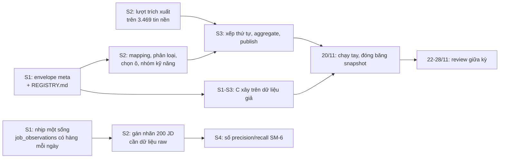

# Chia việc 3 người × 8 sprint

Tài liệu này dịch 28 AD của `ARCHITECTURE-SPINE.md` thành ai-làm-gì-tuần-nào. Nó không thay kế hoạch 8 sprint ở addendum brief; nó xếp lại kế hoạch đó theo **thứ tự phụ thuộc mà kiến trúc áp đặt**, và chỉ ra chỗ không kịp.

Mốc cố định: Sprint 1 là 2–8/11, mỗi sprint một tuần, Sprint 8 kết thúc 27/12. **Review giữa kỳ 22–28/11** (cuối Sprint 3). Nộp báo cáo 20–25/12.

## 1. Ba vai, chia theo ranh giới package của spine

Chia theo package chứ không theo tính năng. Lý do: AD-1 đã cố định hướng phụ thuộc, nên ranh giới package là ranh giới ít xung đột merge nhất, và mỗi người sở hữu trọn một tầng thay vì ba người cùng sửa `domain/`.

| Vai | Sở hữu | AD chịu trách nhiệm chính |
|---|---|---|
| **A — Bên ghi** | `haido_core/crawl/`, phần `steps/` trước `extract`, `haido_pipeline/`, vận hành | AD-4, AD-15, AD-16, AD-18 (phần hạ tầng), AD-20, AD-21, AD-25, AD-27, AD-28 |
| **B — Miền nghiệp vụ và API** | `haido_core/domain/`, `extract/`, `db/`, phần `steps/` từ `mapping` trở đi, `haido_api/` | AD-2, AD-3, AD-5, AD-6, AD-7, AD-8, AD-9, AD-10, AD-11, AD-17, AD-26 |
| **C — Giao diện** | `web/`, trang nội dung công khai | AD-7 (phía đọc), AD-13, AD-14, AD-22, AD-23 |

Việc **không ai sở hữu một mình**, phải làm chung:

- **Bộ từ vựng kỹ năng song ngữ và đồ thị học trước** (AD-12): cần phán đoán chuyên môn, không phải code. B dựng khung dữ liệu, cả ba cùng soạn nội dung, giảng viên rà soát và có biên bản — AD-12 bắt mỗi cạnh có nguồn, và FR-22 bắt mỗi vai trò có biên bản trước khi bật.
- **Gán nhãn 200 JD**: bắt buộc **hai người**, cộng 50 JD cả hai cùng gán để tính Cohen's kappa. Không phải việc một người làm nhanh.
- **Cổng CI của AD-24**: mỗi người viết cổng cho AD mình sở hữu. Chín cổng, không dồn cho một người.

## 2. Hai hợp đồng phải chốt trong Sprint 1, nếu không cả ba cùng tắc

Đây là phần quan trọng nhất của tài liệu. Ba người chỉ làm song song được nếu hai thứ sau tồn tại trước mọi thứ khác:

1. **Envelope `meta` của AD-17.** Chốt nó ở tuần 1 dưới dạng schema Pydantic + một endpoint trả dữ liệu giả. C xây được toàn bộ giao diện trên dữ liệu giả đó mà không chờ B, và khi B nối dữ liệu thật vào thì không phải sửa giao diện. Không có bước này, C ngồi chờ tới Sprint 3.
2. **`REGISTRY.md` của AD-2** với tám chữ ký hàm, chưa cần thân hàm. B và A cùng đọc nó để biết ai gọi gì, và nó chặn sẵn việc hai người cài hai bản của cùng một phép — thứ mà cổng rà soát đã chứng minh là rủi ro lớn nhất của dự án.

## 3. Lịch theo sprint

Chữ **[P0]** là bắt buộc cho review giữa kỳ; **[P1]** bắt buộc trước khi công khai; **[P2]** làm nếu kịp.

### Sprint 1 — 2–8/11 · Nhịp một phải sống

| | A | B | C |
|---|---|---|---|
| | **[P0]** `crawl(cfg) -> Iterator[RawJob]` cho 4 nguồn tự động (CareerLink, ITNavi, Zalo, MoMo), bọc các `parse_*` cũ — **không viết lại chúng** (AD-16) | **[P0]** schema `meta` của AD-17 + endpoint dữ liệu giả | **[P0]** khung Next.js 16, Tailwind, module `localStorage` của AD-23 với danh sách khóa đóng |
| | **[P0]** cổng `polite` thành `haido_core/crawl/` + bảng `crawl_exceptions` hai mức (AD-20) | **[P0]** `REGISTRY.md` với tám chữ ký (AD-2) | **[P1]** trang chính sách dữ liệu (FR-47) — tĩnh, không chờ ai |
| | **[P0]** bước `redact` (AD-21) và `ingest` → `job_postings` + `job_observations` | **[P0]** `db/` + Alembic, **một head duy nhất** (AD-25) | |
| | **[P0]** **bật lịch hằng ngày cho nhịp một** (AD-28) | **[P1]** bảng cấu hình có phiên bản (AD-10) | |
| | **[P1]** `pg_dump` hằng ngày ra ngoài VPS (AD-25) | | |

Việc giấy tờ, chia đều: gửi email xin phép ITviec, TopCV, tác giả repo gốc.

**Ranh giới không được vượt:** cuối tuần này, `job_observations` phải có hàng mới mỗi ngày. Mọi thứ khác trong sprint này có thể trượt; việc này thì không. Lý do ở AD-28: một snapshot là ảnh chụp một ngày đã qua.

### Sprint 2 — 9–15/11 · Bộ máy, và lượt trích xuất dữ liệu nền

| | A | B | C |
|---|---|---|---|
| | **[P0]** nhập dữ liệu nền thành snapshot gốc: `is_backfill`, `times_seen = 1`, `text_provenance = rewritten_en` (AD-19) | **[P0]** cổng `extract/` dùng `output_config.format`, **không** `tool_choice` cưỡng bức (AD-9) | **[P0]** luồng tải CV + ba lựa chọn xác nhận của FR-21, trên dữ liệu giả |
| | **[P0]** `dedupe` trong nguồn, đặt **trước** `extract` để LLM không chạy trên bản sao | **[P0]** phép 1 (mapping) và phép 6 (phân loại) của registry; đổi taxonomy theo FR-7 | **[P0]** đồ thị lộ trình bằng `@xyflow/react`, trên dữ liệu giả |
| | **[P1]** bảng `source_crawl_state`, bỏ trạng thái trong file (AD-16) | **[P0]** **một lượt trích xuất trên 3.469 tin nền** | **[P1]** `GET ...?have=` nối vào API thật khi B xong (AD-22) |
| | | **[P0]** phép 2 (chọn ô), phép 3 (dân số), phép 4 (nhóm kỹ năng); `stat_cells`, `stat_skill_rate` **dày** (AD-5) | |
| | | **[P0]** hiệu chỉnh θ một lần rồi đóng băng (FR-9) | |

Cả nhóm: bắt đầu **gán nhãn 200 JD trên dữ liệu `raw` thu từ Sprint 1** (AD-19). Hai người gán, 50 JD trùng để tính kappa. Bộ từ vựng v1 + đồ thị học trước cho hai nhánh demo, gửi giảng viên rà soát.

### Sprint 3 — 16–22/11 · Vertical slice, chạy bằng lệnh

| | A | B | C |
|---|---|---|---|
| | **[P0]** `cluster` chéo nguồn, **sau** mapping (AD-27) + quy tắc chọn đại diện | **[P0]** phép 8 (xếp thứ tự 4 tầng) + `aggregate` + `publish` (AD-4) | **[P0]** nối toàn bộ Cố vấn vào API thật |
| | **[P1]** `stat_job_lifecycle` vật hóa theo snapshot (AD-4) | **[P0]** API chỉ đọc cho Cố vấn, đúng envelope `meta` | **[P0]** chế độ thẻ trên điện thoại cho FR-21 |
| | **[P2]** bắt đầu bọc Dagster | **[P1]** sự kiện ẩn danh (AD-11, AD-18) | **[P1]** link chia sẻ + tải kết quả (FR-15, FR-16) |

**Ngày 20/11: chạy tay một lần toàn chuỗi nhịp hai** cho Java Backend và Data Engineer, đánh dấu `published`, đóng băng. Đây là snapshot dùng cho review giữa kỳ. Chạy tay là đường chính, không phải đường tắt — AD-15 đã bắt mỗi bước là một lệnh CLI.

**Ngày 21/11: tập dượt demo.** Không đụng code sau mốc này cho tới sau buổi review.

### Sprint 4 — 23–29/11 · Soi tin

| | A | B | C |
|---|---|---|---|
| | **[P1]** bọc Dagster xong: ba service + daily partition timezone tường minh (AD-15) | **[P1]** phép 5 (phân vị, mốc, CI) với seed dẫn xuất theo khóa (AD-26) | **[P1]** màn hình Soi tin đầy đủ, chạy đủ trên điện thoại |
| | **[P1]** `pipeline_run` + báo động giảm > 50% (FR-1) | **[P1]** mức khớp FR-28, dấu hiệu D1–D7, chất lượng JD FR-46 — tất cả qua registry | **[P1]** chế độ 2D/bảng bắt buộc (FR-36) |
| | **[P1]** phép 7 dùng lại cho FR-32 (khớp tin dán) | **[P1]** `unknown_mentions_pasted` + khóa ngoại trên `anon_events` (AD-11) | |

B phải đo ở sprint này: **độ trễ đường người dùng dán** đối chiếu ngân sách 15 giây (AD-9), và **thời gian chạy bootstrap** đối chiếu "một lượt chạy đồng thời" (AD-15).

### Sprint 5 — 30/11–6/12 · Bản đồ, và công khai

| | A | B | C |
|---|---|---|---|
| | **[P1]** `takedown_requests` + `source_exclusions` áp trước `aggregate` (AD-21) | **[P1]** API cho bản đồ với `meta` nhiều ô (AD-17) | **[P1]** bản đồ 3D theo tỷ trọng + `low_sample_shown` cho Đà Nẵng (AD-17) |
| | **[P1]** phục hồi thử từ `pg_dump`, có biên bản (AD-25) | **[P1]** thêm 2–3 vai trò cho lộ trình | **[P1]** **trang nội dung công khai**: một trang cho mỗi vai trò lúc công khai (4–5, FR-48), cộng trang chính sách (FR-47); ISR + mồi `GET` (AD-13) |

**Công khai cuối sprint.** Tiêu chí nghiệm thu là FR-48. Review giữa kỳ không phụ thuộc trang này.

### Sprint 6 — 7–13/12 · Insights và chế độ thử nghiệm

| | A | B | C |
|---|---|---|---|
| | **[P1]** vận hành: theo dõi lượt chạy, xử lý nguồn lỗi | **[P1]** năm loại thẻ Insights, tính sẵn, mẫu câu cố định (FR-39) | **[P1]** trang Insights + lọc theo vai trò |
| | **[P1]** sao lưu `eval_*` sau mỗi ngày có phiên thử | **[P1]** API eval | **[P1]** **chế độ thử nghiệm FR-41..FR-45 xong đầu sprint**, chạy đủ trên điện thoại |

Cả nhóm: soạn `eval_fixtures/` — tình huống mẫu và câu trả lời ChatGPT, JSON tĩnh có phiên bản (AD-18). **Bắt đầu thử nghiệm người dùng từ giữa sprint.**

### Sprint 7 — 14–20/12 · Thử nghiệm 30–50 người

Cả ba cùng chạy thử nghiệm và sửa lỗi. B lo truy vấn xuất kết quả một câu (FR-45). A canh pipeline và sao lưu — **mất dữ liệu eval ở tuần này là mất không lấy lại được**, vì ẩn danh tuyệt đối nghĩa là không có đường liên lạc với người thử.

Lưu ý từ AD-28: quanh **25/12** dữ liệu nền rơi khỏi cửa sổ 60 ngày. Tuần này là lúc kiểm xem số liệu còn đứng được trên dữ liệu tự thu hay không — trước khi nó thành vấn đề ở buổi bảo vệ.

### Sprint 8 — 21–27/12 · Đóng băng

Code freeze. Báo cáo, slide, tập dượt. Dự phòng.

## 4. Đường găng

Hai thứ chặn nhiều nhất: **envelope `meta`** (chặn C suốt ba sprint) và **nhịp một** (chặn bộ chuẩn 200 JD, và không mua lại được). Cả hai nằm ở Sprint 1.

## 5. Cắt gì nếu trượt

Theo thứ tự cắt, từ ít đau nhất:

1. Số vai trò có lộ trình: 4–5 xuống 2. Hai nhánh demo là đủ cho mọi SM.
2. Trang nội dung công khai (FR-48): hoãn sang sau bảo vệ nếu trượt lịch công khai. Đây là cắt một FR đã có, phải ghi thành phạm vi bị cắt. Review giữa kỳ và bốn bài toán khó không phụ thuộc nó.
3. Thẻ Insights: năm loại xuống hai loại rẻ nhất (cửa vào cho người mới, bộ kỹ năng hay đi cùng nhau).
4. Bọc Dagster: giữ nguyên chuỗi lệnh CLI cộng `cron`. AD-15 đã làm việc này rẻ, và hội đồng mất một cái tên công cụ chứ không mất một kết quả kiểm chứng được nào.

**Không được cắt**, dù trượt: nhịp một hằng ngày (AD-28), chín cổng CI (AD-24), sao lưu (AD-25), bộ chuẩn 200 JD (SM-6 và bài toán khó số 2 phụ thuộc nó), chế độ thử nghiệm (không có nó thì không có chương Thực nghiệm).

## 6. Chỗ tôi cho rằng kế hoạch còn rủi ro

- **Sprint 2 là sprint nặng nhất**, và nó cũng là tuần gán nhãn 200 JD. Nếu phải mượn thời gian, mượn từ Sprint 5 (bản đồ) chứ không từ Sprint 2.
- **Bộ chuẩn 200 JD bị dịch sang muộn.** Addendum brief xếp nó ở Sprint 2, nhưng nó cần dữ liệu `raw` từ nhịp một, nên thực tế nó chỉ bắt đầu được giữa Sprint 2 và kéo sang Sprint 3. Số SM-6 vì thế về sớm nhất ở Sprint 4.
- **Chỉ số tiếng Việt phụ thuộc lượng dữ liệu `raw` thu được.** Nếu đến Sprint 4 mà dữ liệu `raw` còn quá ít, con số tách riêng cho kỹ năng tiếng Việt sẽ có cỡ mẫu nhỏ. Đây là rủi ro của bài toán khó số 2, và nó không có đường tránh nào ngoài việc thu đủ sớm.
